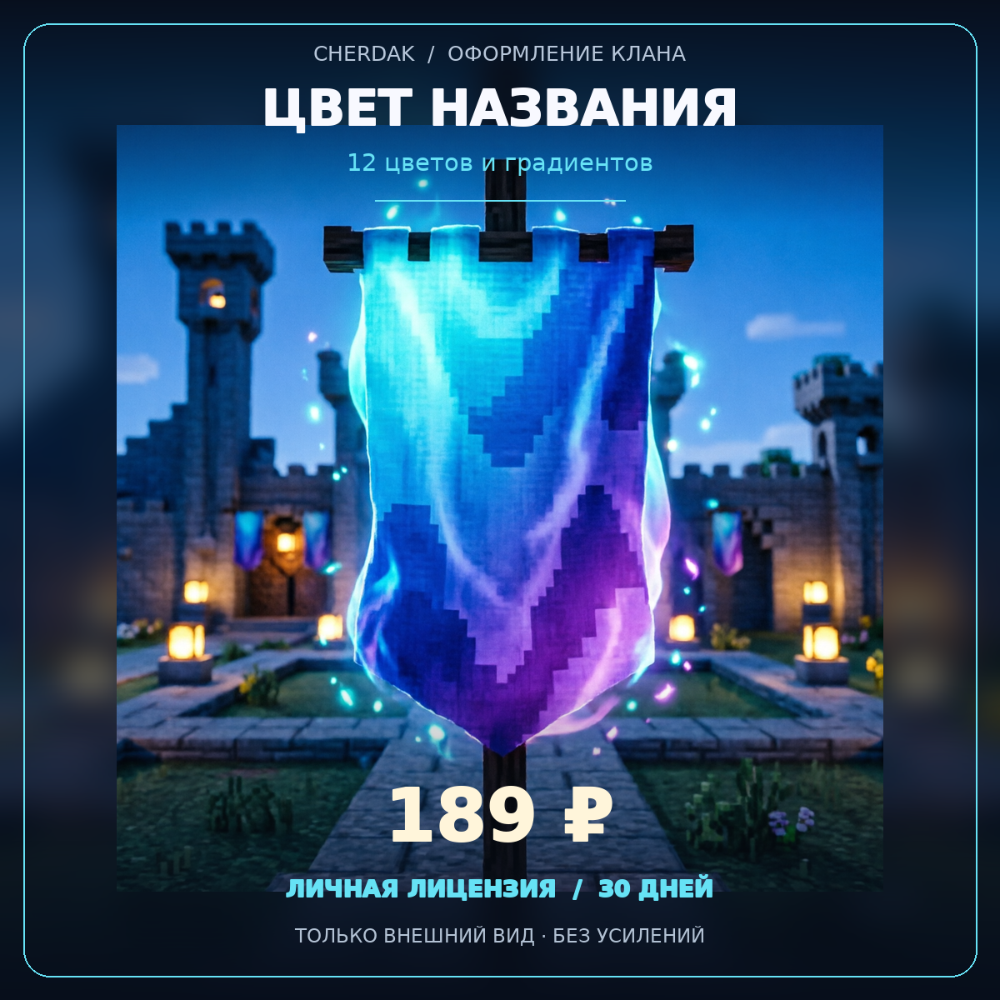
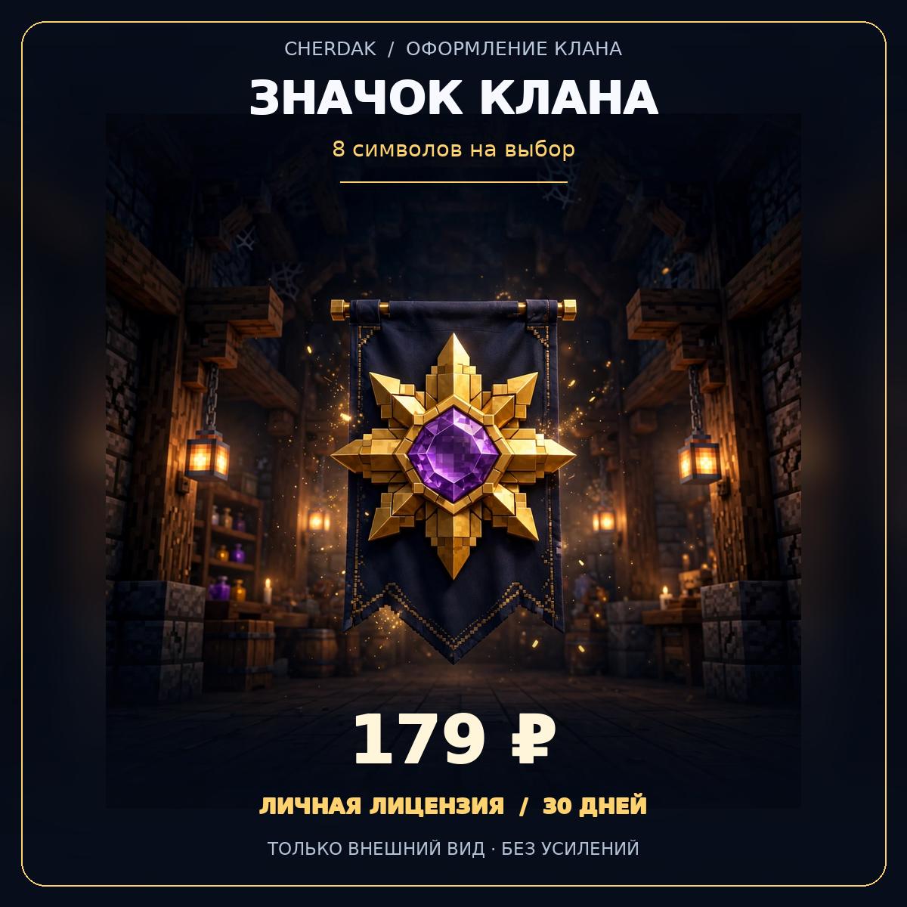
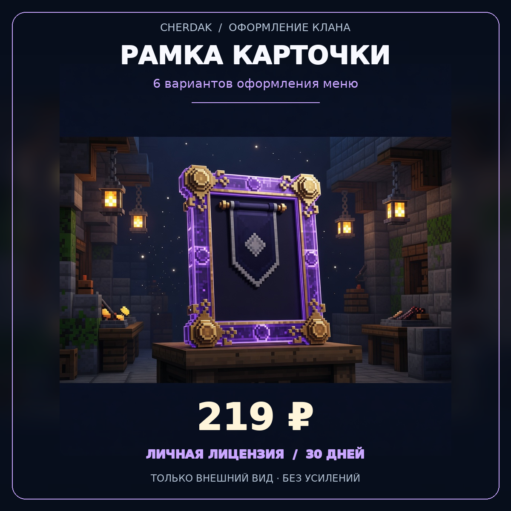

# CHERDAK — три товара оформления клана

Материалы для механик версии 1.4.278. Подготовка карточек не означает публикацию магазина или установку плагинов.

Для каждой карточки используйте её PNG, описание ниже, цену и **одну** основную RCON-команду.

## Цвет названия клана — 189 ₽ / 30 дней



ID: `clan-name-style` · PNG 1200 × 1200

### Описание для карточки

Пусть ваш клан узнают с первого взгляда! Выбирайте один из 12 цветов и градиентов для названия клана и его чат-тега. Оформление видно в информации о клане, профиле и карточке меню. Служебные красные и зелёные обозначения режима клана в TAB сохраняются.

Личная лицензия покупателя на 30 дней. Срок начинается с выдачи покупки, а не с первого применения. Каждый товар приобретается отдельно; ранг, включая V, его не заменяет. В существующий набор «Всё включено» эти лицензии не входят.

Все выбранные украшения одного покупателя действуют для одного его клана. Перенос всего выбора в другой свой клан доступен не чаще раза в реальные 24 часа, в том числе после первого назначения. Снятие эффекта не сбрасывает этот срок.

Глава применяет свою покупку самостоятельно. Предложение обычного участника глава подтверждает командой /clan style accept Ник в течение 2 минут. Покупатель должен быть в сети, авторизован и оставаться в этом клане. При переносе одобряется весь выбранный комплект покупателя.

Если покупатель выходит из клана, его исключают, покупка истекает или отзывается, его оформление перестаёт отображаться. Лицензия не переходит новому главе. Выбор сохраняется и может снова действовать при продлении покупки и действующем членстве. Новый клан с прежним названием не наследует оформление автоматически.

При нескольких спонсорах одного типа показывается последний одобренный действующий вариант; после его снятия или истечения может вернуться вариант другого участника. Глава может убрать оформление клана, не отзывая личную покупку.

Только внешний вид: без силы, дополнительных мест, прав на землю, изменений казны и боевых преимуществ. Можно сочетать три разных типа оформления при наличии трёх действующих лицензий.

Повторная покупка продлевает срок этой лицензии, а не создаёт вторую независимую лицензию. Если весь оплаченный период не помещается в общий горизонт 365 дней, выдача требует ручной сверки; дни не должны молча обрезаться. Возможные бонусные дни действуют только по настройкам сервера, не обещаются этой карточкой.

Картинка — художественная иллюстрация косметического оформления. Физические предметы и нарисованные постройки покупкой не выдаются.

После покупки: /clan style — варианты, сроки и правила. Пример выбора: /clan style name aurora.

### Основная команда выдачи

```text
pass shopbuy %username% clan-name-style
```

## Значок клана — 179 ₽ / 30 дней



ID: `clan-emblem` · PNG 1200 × 1200

### Описание для карточки

Добавьте клану узнаваемый символ! Лицензия открывает выбор одного из 8 готовых значков: звёзды, ромб, искра, лилия, солнце, снежинка и луна. Значок дополняет название в информации о клане, профиле и карточке меню, а также чат-тег. Это символ оформления, не предмет с характеристиками.

Личная лицензия покупателя на 30 дней. Срок начинается с выдачи покупки, а не с первого применения. Каждый товар приобретается отдельно; ранг, включая V, его не заменяет. В существующий набор «Всё включено» эти лицензии не входят.

Все выбранные украшения одного покупателя действуют для одного его клана. Перенос всего выбора в другой свой клан доступен не чаще раза в реальные 24 часа, в том числе после первого назначения. Снятие эффекта не сбрасывает этот срок.

Глава применяет свою покупку самостоятельно. Предложение обычного участника глава подтверждает командой /clan style accept Ник в течение 2 минут. Покупатель должен быть в сети, авторизован и оставаться в этом клане. При переносе одобряется весь выбранный комплект покупателя.

Если покупатель выходит из клана, его исключают, покупка истекает или отзывается, его оформление перестаёт отображаться. Лицензия не переходит новому главе. Выбор сохраняется и может снова действовать при продлении покупки и действующем членстве. Новый клан с прежним названием не наследует оформление автоматически.

При нескольких спонсорах одного типа показывается последний одобренный действующий вариант; после его снятия или истечения может вернуться вариант другого участника. Глава может убрать оформление клана, не отзывая личную покупку.

Только внешний вид: без силы, дополнительных мест, прав на землю, изменений казны и боевых преимуществ. Можно сочетать три разных типа оформления при наличии трёх действующих лицензий.

Повторная покупка продлевает срок этой лицензии, а не создаёт вторую независимую лицензию. Если весь оплаченный период не помещается в общий горизонт 365 дней, выдача требует ручной сверки; дни не должны молча обрезаться. Возможные бонусные дни действуют только по настройкам сервера, не обещаются этой карточкой.

Картинка — художественная иллюстрация косметического оформления. Физические предметы и нарисованные постройки покупкой не выдаются.

После покупки: /clan style — варианты, сроки и правила. Пример выбора: /clan style emblem crown.

### Основная команда выдачи

```text
pass shopbuy %username% clan-emblem
```

## Рамка карточки клана — 219 ₽ / 30 дней



ID: `clan-card-frame` · PNG 1200 × 1200

### Описание для карточки

Сделайте меню своего клана особенным! Выбирайте одну из 6 декоративных рамок: золотую, аметистовую, океанскую, лесную, огненную или морозную. Рамка оформляет свободные края меню клана и не перекрывает кнопки. Это оформление интерфейса, не блок, не физический предмет и не портал.

Личная лицензия покупателя на 30 дней. Срок начинается с выдачи покупки, а не с первого применения. Каждый товар приобретается отдельно; ранг, включая V, его не заменяет. В существующий набор «Всё включено» эти лицензии не входят.

Все выбранные украшения одного покупателя действуют для одного его клана. Перенос всего выбора в другой свой клан доступен не чаще раза в реальные 24 часа, в том числе после первого назначения. Снятие эффекта не сбрасывает этот срок.

Глава применяет свою покупку самостоятельно. Предложение обычного участника глава подтверждает командой /clan style accept Ник в течение 2 минут. Покупатель должен быть в сети, авторизован и оставаться в этом клане. При переносе одобряется весь выбранный комплект покупателя.

Если покупатель выходит из клана, его исключают, покупка истекает или отзывается, его оформление перестаёт отображаться. Лицензия не переходит новому главе. Выбор сохраняется и может снова действовать при продлении покупки и действующем членстве. Новый клан с прежним названием не наследует оформление автоматически.

При нескольких спонсорах одного типа показывается последний одобренный действующий вариант; после его снятия или истечения может вернуться вариант другого участника. Глава может убрать оформление клана, не отзывая личную покупку.

Только внешний вид: без силы, дополнительных мест, прав на землю, изменений казны и боевых преимуществ. Можно сочетать три разных типа оформления при наличии трёх действующих лицензий.

Повторная покупка продлевает срок этой лицензии, а не создаёт вторую независимую лицензию. Если весь оплаченный период не помещается в общий горизонт 365 дней, выдача требует ручной сверки; дни не должны молча обрезаться. Возможные бонусные дни действуют только по настройкам сервера, не обещаются этой карточкой.

Картинка — художественная иллюстрация косметического оформления. Физические предметы и нарисованные постройки покупкой не выдаются.

После покупки: /clan style — варианты, сроки и правила. Пример выбора: /clan style frame amethyst.

### Основная команда выдачи

```text
pass shopbuy %username% clan-card-frame
```

## Важно владельцу

См. [инструкцию](README.md) и [отдельный файл команд](КОМАНДЫ_RCON.txt). Игровые команды выбора оформления не являются командами выдачи и не должны исполняться из карточки магазина.
