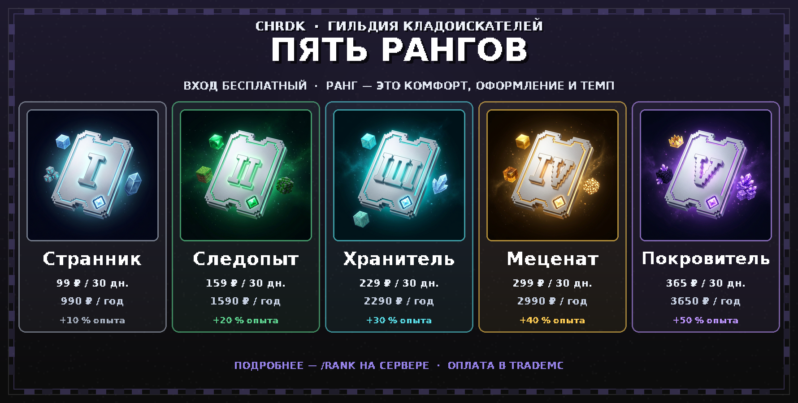
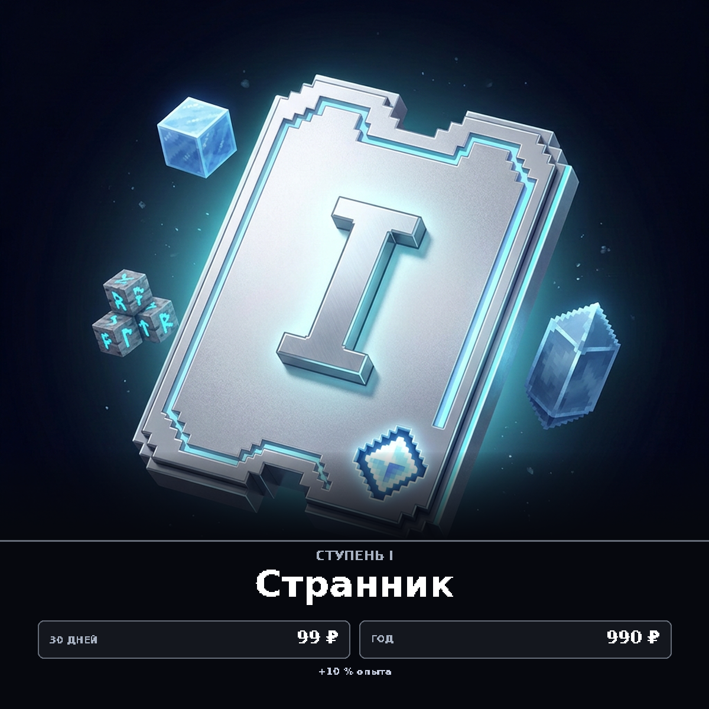
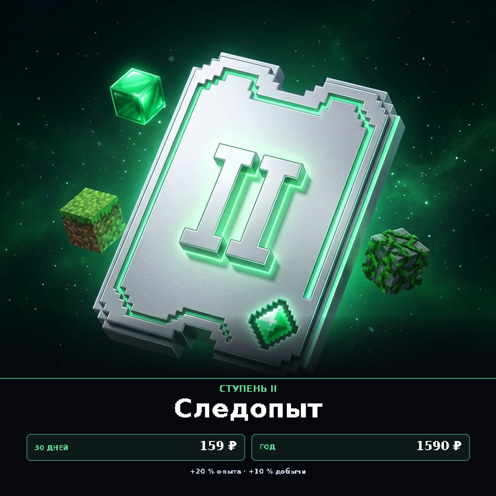
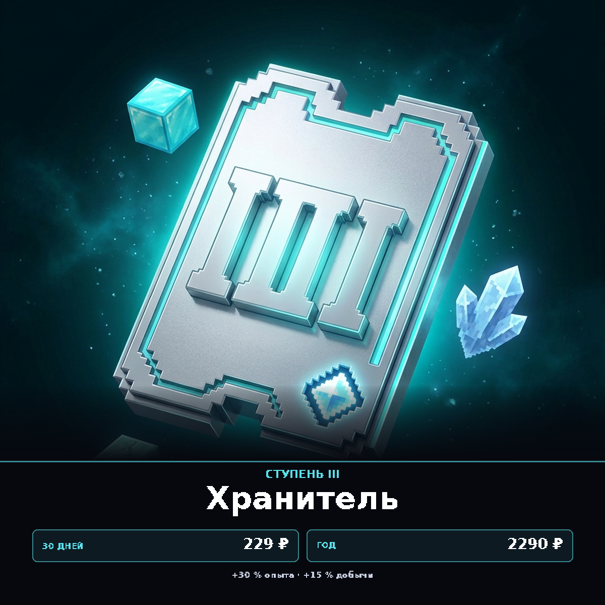
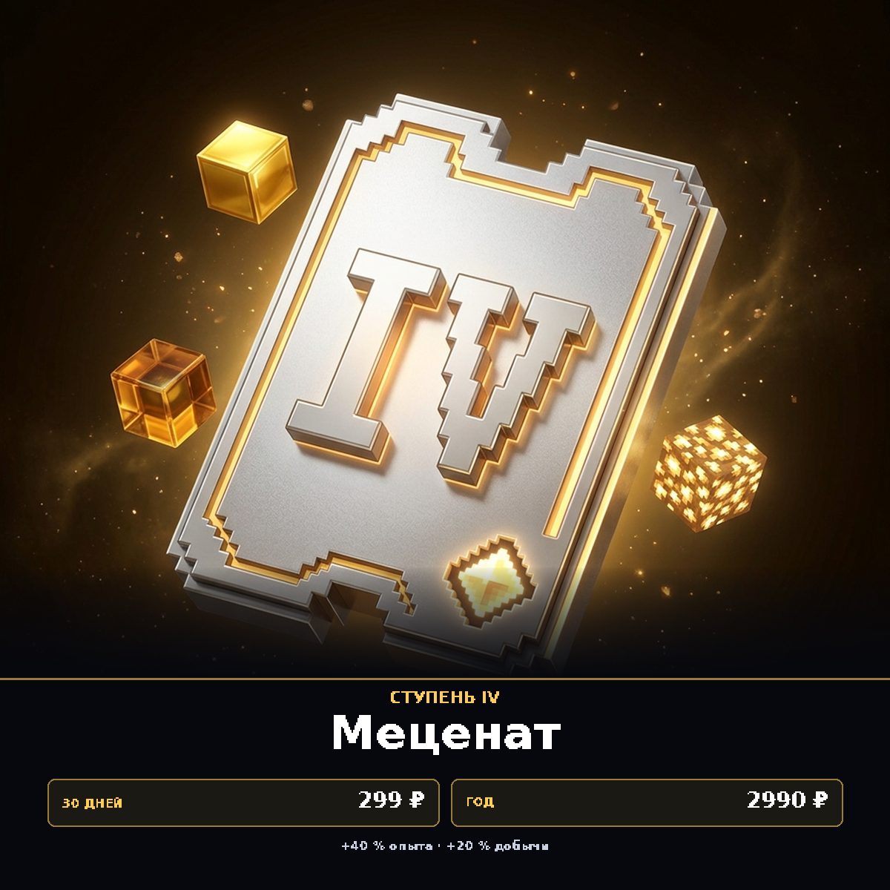
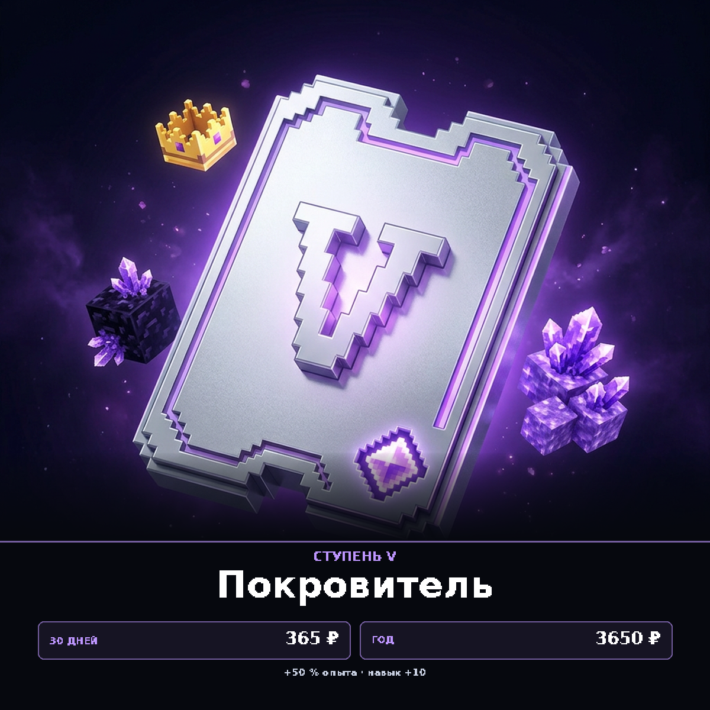

# Карточки витрины рангов — галерея

Все картинки для панели [TradeMC](https://trademc.org). Ниже — сами файлы и
команда, которая привязывается к товару. Полные тексты описаний, цены и порядок
заполнения — в [`SHOP-TRADEMC.md`](../SHOP-TRADEMC.md). Архив со всеми шестью
PNG — [`chrdk-shop-images.zip`](../chrdk-shop-images.zip).

> Команда выполняется **от консоли сервера**, без слэша. `%username%` — поле
> ника в форме товара TradeMC. Цена в команде — единственный ключ, по которому
> ядро находит товар: поменяли цену в панели — поменяйте число в команде.

---

## Обложка раздела «Ранги» — `00-vse-ranki.png`

1780×900, ставится в описание раздела или категории. Команды у обложки нет.



---

## ✦ Странник — `1-strannik.png`

| Товар | Цена | Команда |
|---|--:|---|
| ✦ Странник — 30 дней | 99 | `pass shoppay %username% 99` |
| ✦ Странник — год | 990 | `pass shoppay %username% 990` |



---

## ❖ Следопыт — `2-sledopyt.png`

| Товар | Цена | Команда |
|---|--:|---|
| ❖ Следопыт — 30 дней | 159 | `pass shoppay %username% 159` |
| ❖ Следопыт — год | 1590 | `pass shoppay %username% 1590` |



---

## ✧ Хранитель — `3-khranitel.png`

| Товар | Цена | Команда |
|---|--:|---|
| ✧ Хранитель — 30 дней | 229 | `pass shoppay %username% 229` |
| ✧ Хранитель — год | 2290 | `pass shoppay %username% 2290` |



---

## ★ Меценат — `4-metsenat.png`

| Товар | Цена | Команда |
|---|--:|---|
| ★ Меценат — 30 дней | 299 | `pass shoppay %username% 299` |
| ★ Меценат — год | 2990 | `pass shoppay %username% 2990` |



---

## ⚜ Покровитель — `5-pokrovitel.png`

| Товар | Цена | Команда |
|---|--:|---|
| ⚜ Покровитель — 30 дней | 365 | `pass shoppay %username% 365` |
| ⚜ Покровитель — год | 3650 | `pass shoppay %username% 3650` |



---

## Как перерисовать

Стиль — 3D-пиксельный: металлическая табличка с римской цифрой, неоновый кант
в цвете ступени, вокруг кубы и кристаллы. Исходный арт лежит в
[`art/`](art/) (1024×1024, по файлу на ступень), карточки и обложку собирает
[`compose_ai.py`](compose_ai.py) (Python 3 + Pillow, шрифт DejaVu Sans Bold):

```
python3 docs/ranks/shop/compose_ai.py             # все карточки и обложка
python3 docs/ranks/shop/compose_ai.py --card 3    # только «Хранитель»
python3 docs/ranks/shop/compose_ai.py --overview  # только обложка
python3 docs/ranks/shop/compose_ai.py --zip       # пересобрать архив для панели
```

Цены, бонусы и цвета плашек правятся в списке `RANKS` в начале `compose_ai.py`.
Заменили арт — перезапустите скрипт, надписи встанут на место сами.

Есть и запасной вариант — полностью векторный [`generate.py`](generate.py):
рисует карточки целиком кодом (изометрические кубы, пиксельные эмблемы,
блочная рамка), без готового арта.
