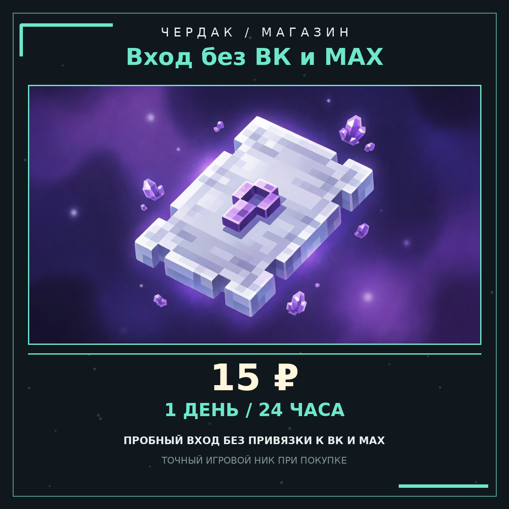

# Товар «Вход без ВК и MAX — 1 день» (`social-access-day`)

Короткий пробный тариф: **15 ₽ / 1 день (24 часа)** играть без обязательной
привязки к ВКонтакте или MAX. Это **не ранг и не привилегия** — только снятие
заморозки лобби на оплаченные сутки. Полный тариф остаётся прежним:
[`social-access`, 150 ₽ / 30 дней](social-access.md).



| Поле | Значение |
| --- | --- |
| Название | Вход без ВК и MAX — 1 день |
| `id` товара | `social-access-day` |
| Цена | **15 ₽** |
| Срок | **1 день** (24 часа с момента выдачи) |
| Продление | повторная покупка добавляет 1 день, потолок 365 дней (`shop.max-total-days`) |
| Группа LuckPerms | `social-day`, вес 20, родитель `default` |
| Право группы | `chrdksocial.bypass` (только на срок покупки) |
| Картинка | `docs/shop/social-access-day.png` (1200×1200, PNG) |
| Команда выдачи | см. ниже |

## Команда для товара на сайте

```
pass shopbuy %username% social-access-day
```

Без начального `/`: TradeMC выполняет команду через RCON/панель, а
`%username%` подставляет точный игровой ник, указанный при оплате. Срок берётся
из товара (`days: 1`), поэтому необязательный аргумент `[дней]` сайту не нужен.
`pass shoppay %username% 15` **не подходит**: оплата по сумме выдаёт ранг/баланс,
а не этот entitlement и не группу `social-day`.

## Два независимых механизма доступа

Товар намеренно дублирует доступ, чтобы покупка не терялась при сбое одной из
подсистем:

1. **Entitlement ядра (основной).** `pass shopbuy` пишет срок в
   `data.json` → `entitlements`. Плагин `CHRDK_VK` читает его через
   `ChrdkRegisterApi.entitlementUntil(ник, "social-access-day")`, потому что id
   добавлен в `social.donate-access.product-ids`:

   ```yaml
   social:
     donate-access:
       enabled: true
       mode: either
       product-ids: [social-access, social-access-day]
       permanent: false
   ```

   `either` сохраняет прежнее правило: любой активный донатный ранг/проходка
   **или** любой товар из списка снимают ограничение. Косметика, дома и шлейфы
   обхода не дают. При недоступном API ядра или пустом ответе вход закрывается
   (**fail-closed**), право не выдаётся «на всякий случай».

2. **Временная группа LuckPerms (дополнительный).** У товара есть `group:
   "social-day"` и `permissions: ["chrdksocial.bypass"]`. Ядро выдаёт группу на
   тот же срок и снимает её по истечении; `chrdksocial.bypass` — это узел из
   `social.bypass-permission` плагина `CHRDK_VK`. Группу создаёт
   `/pass luckperms setup` (или вручную через редактор luckperms.net), см.
   [настройку LuckPerms](../luckperms-setup.md).

> **Важно:** `chrdksocial.bypass` нельзя добавлять в группы `default` или
> `admin` — иначе обязательная привязка обходится у всех игроков.
> `/pass luckperms setup` теперь явно вырезает этот узел из базовых и
> административных прав, даже если плагин зарегистрировал его нестандартно.
> Имя узла настраивается в `integrations.lp-social-bypass-permission` ядра и
> должно совпадать с `social.bypass-permission` в `plugins/CHRDK_VK/config.yml`.

## Что настроено в плагинах

**`plugins/CHRDK_Core/config.yml`** — товар в `shop.products`:

```yaml
    - id: social-access-day
      name: "<aqua>Вход без ВК и MAX — 1 день</aqua>"
      price: 15
      days: 1
      group: "social-day"
      description: "Играть без обязательной привязки к ВКонтакте или MAX — 1 день (24 часа). Не выдаёт ранг, привилегии и игровые бонусы"
      tag: ""
      permissions: ["chrdksocial.bypass"]
      commands: []
      trademc-export: false
```

`trademc-export: false` означает, что товар **не попадает в комплект из 26
карточек** `docs/trademc/`: у него своя карточка здесь, как у `social-access`
и клановых лицензий. 27-й карточки TradeMC не появляется, архив PNG,
`manifest.json` и тарифы 300/450/600/750/900 ₽ не пересобираются.

Если `shop.products` на сервере правился вручную, миграция презентационного
конфига намеренно не перезаписывает чужие цены — добавьте блок товара вручную.
Стоковые конфиги получают оба тарифа автоматически.

**`plugins/CHRDK_VK/config.yml`** — см. `product-ids` выше. Ручная выдача
`/social donor grant <ник>` по-прежнему возможна и пишется в аудит.

Карточка и PNG пересобираются командой
`python3 tools/shop/build_social_access_day_card.py` и проверяются
`--check` (размер 1200×1200, цена, срок, команда и узел права в тексте).
Проверка идёт в CI вместе с `tools/shop/build_social_access_card.py --check`.

## Проверка после установки

1. `/pass luckperms setup`, затем `/pass luckperms status` — в списке должна
   появиться группа `social-day` (вес 20, один узел `chrdksocial.bypass`).
2. `pass shopbuy <тестовый_ник> social-access-day` из консоли.
3. `/lp user <тестовый_ник> info` — временная группа `social-day` с сроком 1d.
4. Зайти тестовым аккаунтом без привязки: лобби не frozen, в TAB статус прохода.
5. Через сутки группа снимается, entitlement истекает, ограничение возвращается.

Живой сервер, RCON и игровой smoke в этой поставке не выполнялись.
