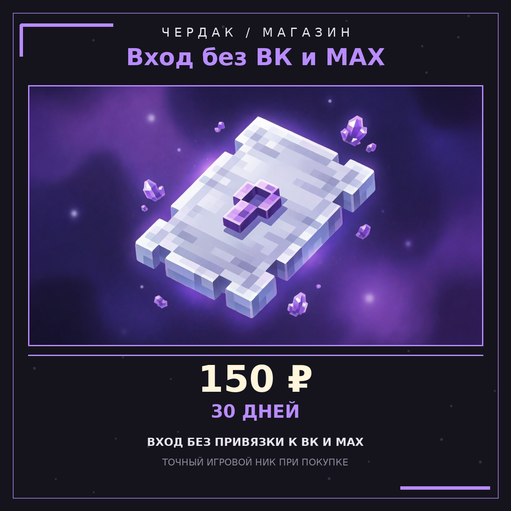

# Товар «Вход без ВК и MAX» (`social-access`)

Карточка для сайта донатов (TradeMC): даёт играть без обязательной привязки к
ВКонтакте или MAX. Это **не ранг и не привилегия** — только снятие заморозки
лобби на оплаченный срок.



| Поле | Значение |
| --- | --- |
| Название | Вход без ВК и MAX |
| `id` товара | `social-access` |
| Цена | **150 ₽** |
| Срок | **30 дней** |
| Продление | повторная покупка добавляет 30 дней, потолок 365 дней (`shop.max-total-days`) |
| Картинка | `docs/shop/social-access.png` (1200×1200, PNG) |
| Команда выдачи | см. ниже |

## Команда для товара на сайте

```
pass shopbuy %username% social-access
```

Без начального `/`: TradeMC выполняет команду через RCON/панель, а
`%username%` подставляет точный игровой nick, который покупатель указал при
оплате. Именно `%username%`, а не `%player%` и не чат игрока: подтверждением
оплаты служит только запись в `data.json` ядра, сделанная этой командой.

Команда уже работает без правок кода: `pass shopbuy <ник> <id_товара> [дней]`
читает товар из `shop.products` в `plugins/CHRDK_Core/config.yml`. Опциональный
`[дней]` для сайта **не нужен** — срок берётся из товара (30).

Альтернативу по сумме `pass shoppay %username% 150` рекламировать не следует:
`shoppay` выдаёт ранг/баланс по сумме, а не entitlement `social-access`, поэтому
не снимает заморозку лобби. Цена 150 ₽ уникальна среди товаров каталога, но
доставка должна идти по `id`.

## Что настроено в плагинах

**`plugins/CHRDK_Core/config.yml`** — товар в `shop.products`:

```yaml
    - id: social-access
      name: "<aqua>Вход без ВК и MAX</aqua>"
      price: 150
      days: 30
      group: ""
      description: "Играть без обязательной привязки к ВКонтакте или MAX — 30 дней. Не выдаёт ранг, привилегии и игровые бонусы"
      tag: ""
      permissions: []
      commands: []
      trademc-export: false
```

Если `shop.products` на сервере правился вручную, миграция презентационного
конфига намеренно не перезаписывает чужие цены — в этом случае добавьте блок
товара в `plugins/CHRDK_Core/config.yml` вручную.

`trademc-export: false` означает, что товар **не попадает в комплект из 26
карточек** `docs/trademc/`: у него своя карточка здесь. Тот же флаг уже
используют клановые лицензии. Экспорт TradeMC (`tools/trademc/build.py`)
фильтрует такие товары до проверки уникальности цен, поэтому 27-й карточки
не появляется. При изменении тарифов весь комплект из 26 PNG, TXT, Markdown,
аудита и `manifest.json` пересобирается командой
`python3 tools/trademc/build.py --build` и проверяется `--check`.

**`plugins/CHRDK_VK/config.yml`** — режим платного доступа:

```yaml
social:
  donate-access:
    enabled: true
    mode: either
    product-ids: [social-access, social-access-day]
    permanent: false
    url: "https://chrdk.trademc.org/"
```

`either` означает: **любой активный донатный ранг/проходка ИЛИ товар
`social-access`** снимают ограничение. Ранги стоят от 300 ₽ — дороже карточки
за 150 ₽, поэтому покупателю ранга не нужна отдельная проходка. Прочие товары
(шлейфы, цвета ника, дома) обхода не дают. Ручная выдача
`/social donor grant <ник>` тоже возможна и пишется в `audit/*.jsonl`.
При недоступном `ChrdkRegisterApi` или пустом ответе ядра доступ закрывается
(fail-closed).

### Тарифы: что дороже проходки

Карточка «Вход без ВК и MAX» — **150 ₽ / 30 дней**, самый дешёвый способ снять
ограничение. Все ранги стоят дороже неё:

| Ранг | 30 дней | 365 дней |
| --- | ---: | ---: |
| I Странник | 300 ₽ | 3 000 ₽ |
| II Следопыт | 450 ₽ | 4 500 ₽ |
| III Хранитель | 600 ₽ | 6 000 ₽ |
| IV Меценат | 750 ₽ | 7 500 ₽ |
| V Покровитель | 900 ₽ | 9 000 ₽ |
| Всё включено | 1 499 ₽ | — |

Короткий пробный тариф — **[«Вход без ВК и MAX — 1 день»](social-access-day.md)**,
15 ₽ за 24 часа. Он дешевле любого ранга и этой карточки, но действует только
сутки и дополнительно выдаёт временную группу LuckPerms `social-day`.
Настройка прав описана в [docs/luckperms-setup.md](../luckperms-setup.md).

Минимальный ранг — 300 ₽, годовой тариф равен десяти месячным, все 11 цен
уникальны (это проверяет `tools/trademc/audit.py`). Косметика за 39–69 ₽,
пакеты шлейфов и домов к донатному доступу **не** относятся: выбран `either`,
а не «любой товар на сайте».

## Одна строка привязки в TAB

`plugins/CHRDK_Core/config.yml` → `tablist.footer` содержит одну строку
`%chrdksocial_tab%`. Она приходит из `CHRDK_VK` через PlaceholderAPI и содержит
готовую MiniMessage-разметку: цвет и текст выбирает политика CHRDK_VK, а не две
шаблонные строки ядра.

| Состояние | Что видит игрок |
| --- | --- |
| Привязка ещё не сделана, grace активен | `⚠ Привяжите ВКонтакте: /link → код боту. Осталось 14 дн.` |
| ВКонтакте привязан | `✅ ВКонтакте привязан — можно играть` — **без счётчика и дедлайна** |
| Куплен «Вход без ВК» | `✅ Вход без ВК оплачен: 27 дн. · привязка не нужна` |
| Срок вышел | `⛔ Вход закрыт: /link → код → бот ВКонтакте` |

```yaml
    - "%chrdksocial_tab%"
```

Старые `%chrdksocial_status%`, `%chrdksocial_link%` и `%chrdksocial_access%`
остались в expansion для внешних плагинов, но эталонный footer больше не
печатает два срока подряд. Владельческий конфиг с двумя старыми строками
совмещается рантаймом `TabFooterNormalizer` без перезаписи YAML. Без PAPI или
`CHRDK_VK` строка скрывается целиком, а `VkPlugin` пишет **SEVERE** в лог.

Игрок также получает напоминание с первого входа: заголовок на экране, звук и
блок «СПОСОБ 1 — привязка к ВКонтакте» с пошаговой инструкцией (`/link` → код →
бот сообщества ВК), «СПОСОБ 2 — проход без ВК» (**15 ₽ / 1 день** или 150 ₽ /
30 дней). `/link` дополнительно сжат до одной понятной строки с живым кодом и
ссылкой на сообщество; уже привязанному игроку сразу сообщают, что счётчик в
TAB скрыт. MAX в подсказках не предлагается: модуль в разработке. Настройки —
`social.reminder.*` в `plugins/CHRDK_VK/config.yml`.

Expansion `ru.cherdakmd.chrdksocial.SocialPlaceholders` с идентификатором
`chrdksocial` регистрируется в `VkPlugin.onEnable()` только при установленном
PlaceholderAPI. Срок товара читается из `data.json` ядра через
`ChrdkRegisterApi.entitlementUntil(ник, "social-access")`, то есть переживает
рестарт и `/pass reload`. Персональные связи и `firstSeen` теперь лежат в
`plugins/CHRDK_VK/players/social.yml`; схема и миграция — в
[docs/design/PLAYER-DATA-FILES.md](../design/PLAYER-DATA-FILES.md).

## Проверки перед публикацией

```bash
python3 tools/trademc/build.py --check
python3 -m unittest discover -s tools/trademc -p 'test_*.py'
python3 tools/shop/build_social_access_card.py --check
```

Живая покупка, выдача через панель TradeMC и RCON, истечение срока, установка
на сервер и клиентский smoke в этом изменении **не выполнялись** — требуется
проверка на тестовом сервере после раскатки JAR.
