# ЧЕРДАК — TradeMC: все товары и команды
Версия плагинов: 1.4.220. Каталог: 26 товаров.
Цены и сроки: стандартные настройки этой версии, рубли / календарные дни.
Источник: src/main/resources/config.yml → `shop.products`.

## Как заполнить карточку
1. Создайте товар с указанными ниже ценой, названием и сроком.
2. Прикрепите одноимённую картинку из images/ (PNG, 1200×1200).
3. Скопируйте описание и ОСНОВНУЮ КОМАНДУ. В панели команда без начального /.
4. Доставка — RCON в сервер Minecraft, не чат игрока и не консоль-прокси.
5. `%username%` — подстановка игрового ника в настройках команды TradeMC.
   Панель должна заменять её на реальный ник; не отправляйте строку буквально.
   Синтаксис доступных подстановок проверьте в своей панели. Это НЕ номер заказа.
6. В `CHRDK_Core/config.yml` включите `trademc.enabled: true`. Сохраните актуальный
   `shop.products`. Закройте RCON от посторонних (пароль, firewall, доверенный IP).
7. На один успешный платёж выполняется ровно ОДНА команда: shopbuy ИЛИ shoppay.
   Не выполняйте обе: они означают две доставки. Не запускайте команды «для теста»
   на рабочем аккаунте: это настоящая выдача. Подтвердите оплату перед доставкой.

Доверенная RCON-доставка магазина работает БЕЗ `payment=` и без номера заказа.
Идентификатор в локальном журнале — не подтверждение оплаты. Плагин не проверяет
платёж через API TradeMC и не может отличить повтор RCON-команды от новой покупки.
Не включайте автоматические повторные отправки без сверки результата доставки.
Цены панели должны совпадать с каталогом. ID-команда надёжнее команды по сумме.

Скопировать в карточку нужно только строку команды, не слова «Основная команда».
Описание ниже предназначено для покупателя; технические примечания вынесены сюда.
Лимиты и преимущества соответствуют стандартным конфигам; при изменении сервера
обновите описание и заново соберите комплект. Никаких бесплатных платных товаров
за игровой прогресс нет. Отдельный +10% XP-буст не является платным рангом.

## Каталог: 26 товаров

| № | Товар | Цена | Срок | Картинка |
| --- | --- | ---: | ---: | --- |
| 01 | Странник | 99 ₽ | 30 дней | [PNG](images/01-rank-wanderer.png) |
| 02 | Странник — год | 990 ₽ | 365 дней | [PNG](images/02-rank-wanderer-year.png) |
| 03 | Следопыт | 159 ₽ | 30 дней | [PNG](images/03-rank-pathfinder.png) |
| 04 | Следопыт — год | 1590 ₽ | 365 дней | [PNG](images/04-rank-pathfinder-year.png) |
| 05 | Хранитель | 229 ₽ | 30 дней | [PNG](images/05-rank-keeper.png) |
| 06 | Хранитель — год | 2290 ₽ | 365 дней | [PNG](images/06-rank-keeper-year.png) |
| 07 | Меценат | 299 ₽ | 30 дней | [PNG](images/07-rank-patron.png) |
| 08 | Меценат — год | 2990 ₽ | 365 дней | [PNG](images/08-rank-patron-year.png) |
| 09 | Покровитель | 365 ₽ | 30 дней | [PNG](images/09-rank-founder.png) |
| 10 | Покровитель — год | 3650 ₽ | 365 дней | [PNG](images/10-rank-founder-year.png) |
| 11 | Дома: +8 точек | 109 ₽ | 30 дней | [PNG](images/11-homes-plus.png) |
| 12 | Огненный шлейф | 39 ₽ | 30 дней | [PNG](images/12-trail-flame.png) |
| 13 | Сердечки | 49 ₽ | 30 дней | [PNG](images/13-trail-hearts.png) |
| 14 | Ноты | 59 ₽ | 30 дней | [PNG](images/14-trail-notes.png) |
| 15 | Искры Энда | 69 ₽ | 30 дней | [PNG](images/15-trail-sparkles.png) |
| 16 | Ведьмина магия | 79 ₽ | 30 дней | [PNG](images/16-trail-magic.png) |
| 17 | Торжественный вход | 89 ₽ | 30 дней | [PNG](images/17-join-effect.png) |
| 18 | Цвет ника: Сияние | 119 ₽ | 30 дней | [PNG](images/18-nick-aurora.png) |
| 19 | Цвет ника: Пламя | 129 ₽ | 30 дней | [PNG](images/19-nick-flame.png) |
| 20 | Цвет ника: Жемчуг | 139 ₽ | 30 дней | [PNG](images/20-nick-pearl.png) |
| 21 | Цвет ника: Лагуна | 149 ₽ | 30 дней | [PNG](images/21-nick-lagoon.png) |
| 22 | Цвет ника: Багрянец | 169 ₽ | 30 дней | [PNG](images/22-nick-crimson.png) |
| 23 | Боевой пропуск | 249 ₽ | 90 дней | [PNG](images/23-battlepass-premium.png) |
| 24 | Набор шлейфов | 199 ₽ | 30 дней | [PNG](images/24-trails-pack.png) |
| 25 | Весь вид | 599 ₽ | 30 дней | [PNG](images/25-look-pack.png) |
| 26 | Всё включено | 899 ₽ | 30 дней | [PNG](images/26-all-inclusive.png) |

## 01. Странник — 30 дней

- **ID:** `rank-wanderer`
- **Цена:** 99 ₽
- **Срок:** 30 дней
- **Картинка:** [01-rank-wanderer.png](images/01-rank-wanderer.png)

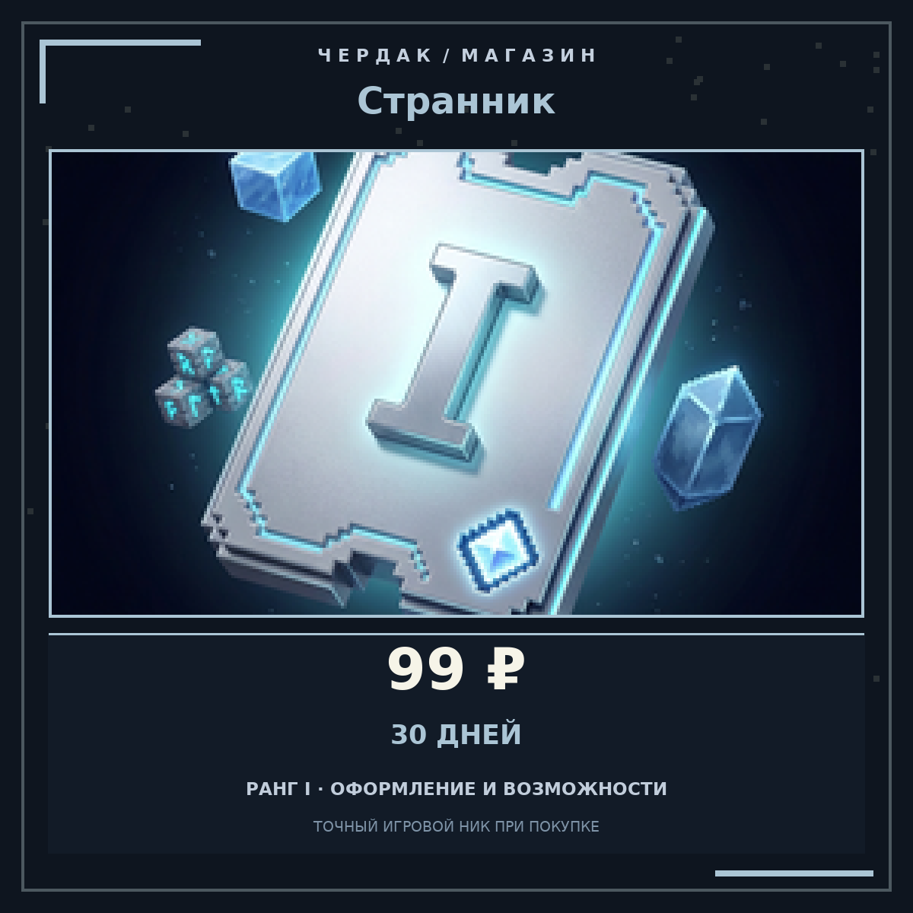

### Описание для товара

- Вход без очереди, знак ✦, +10 % опыта, 4 дома, 28 чанков, скидка 10 %
- Лимиты: дома — 4; чанки привата — 28; лоты аукциона — 12.
- Скидка на платные телепорты: 10%; цена не ниже 1 алмаза.
- Надписи после ника: 2; сохранённых пресетов: 2. Ник всегда первый и не занимает место.
- Опыт профессий: +10%; потолок профессии: 27 (25 + 2 от ранга).
- Количество добычи в находках и охоте: +5% с округлением вниз; это не гарантированное удвоение каждого блока.
- Вход без очереди в рамках вместимости сервера; оформление и возможности предыдущих ступеней.
- Шлейфы по рангу: Огненный шлейф. Одновременно выбирается один.
- Платные цвета ника не входят даже в V: приобретаются отдельно.
- Повторная покупка продлевает срок только если весь оплаченный период помещается в горизонт 365 дней. Младший ранг не заменяет старший; повышение пересчитывает остаток по цене. Невозможная доставка уходит на ручную сверку, а не урезается.

### Основная команда — рекомендуется, RCON

```text
pass shopbuy %username% rank-wanderer
```

### Альтернатива по сумме

**Вместо основной команды, не вместе с ней:**

```text
pass shoppay %username% 99
```

## 02. Странник — год — 365 дней

- **ID:** `rank-wanderer-year`
- **Цена:** 990 ₽
- **Срок:** 365 дней
- **Картинка:** [02-rank-wanderer-year.png](images/02-rank-wanderer-year.png)

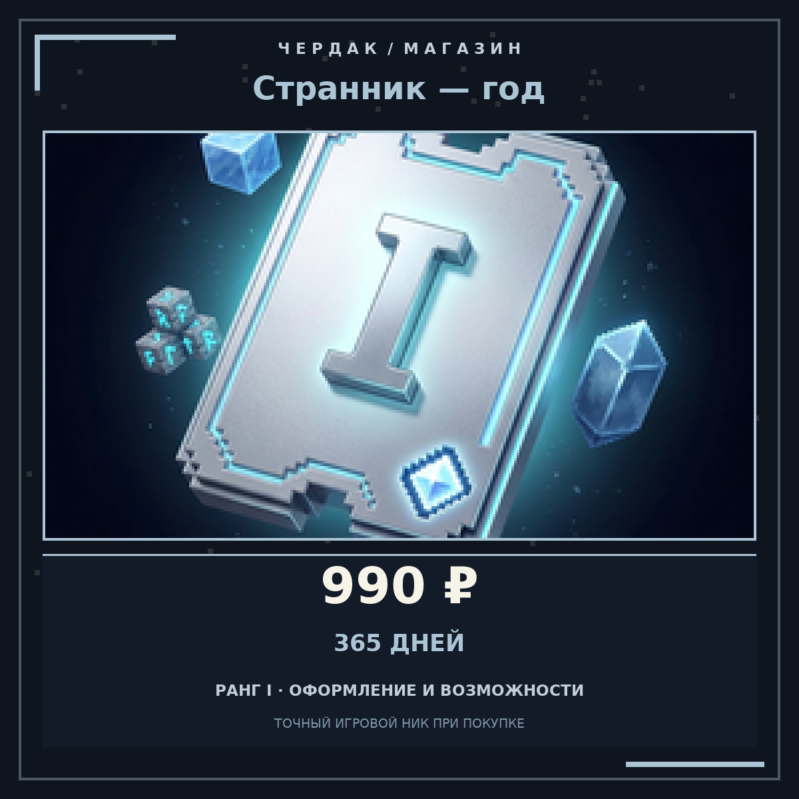

### Описание для товара

- Год Странника: 365 дней по цене десяти покупок по 30 дней
- Вход без очереди, знак ✦, +10 % опыта, 4 дома, 28 чанков, скидка 10 %
- Лимиты: дома — 4; чанки привата — 28; лоты аукциона — 12.
- Скидка на платные телепорты: 10%; цена не ниже 1 алмаза.
- Надписи после ника: 2; сохранённых пресетов: 2. Ник всегда первый и не занимает место.
- Опыт профессий: +10%; потолок профессии: 27 (25 + 2 от ранга).
- Количество добычи в находках и охоте: +5% с округлением вниз; это не гарантированное удвоение каждого блока.
- Вход без очереди в рамках вместимости сервера; оформление и возможности предыдущих ступеней.
- Шлейфы по рангу: Огненный шлейф. Одновременно выбирается один.
- Платные цвета ника не входят даже в V: приобретаются отдельно.
- Повторная покупка продлевает срок только если весь оплаченный период помещается в горизонт 365 дней. Младший ранг не заменяет старший; повышение пересчитывает остаток по цене. Невозможная доставка уходит на ручную сверку, а не урезается.

### Основная команда — рекомендуется, RCON

```text
pass shopbuy %username% rank-wanderer-year
```

### Альтернатива по сумме

**Вместо основной команды, не вместе с ней:**

```text
pass shoppay %username% 990
```

## 03. Следопыт — 30 дней

- **ID:** `rank-pathfinder`
- **Цена:** 159 ₽
- **Срок:** 30 дней
- **Картинка:** [03-rank-pathfinder.png](images/03-rank-pathfinder.png)


### Описание для товара

- Всё из Странника, 3 шлейфа, +20 % опыта, 6 домов, 34 чанка
- Лимиты: дома — 6; чанки привата — 34; лоты аукциона — 15.
- Скидка на платные телепорты: 20%; цена не ниже 1 алмаза.
- Надписи после ника: 2; сохранённых пресетов: 3. Ник всегда первый и не занимает место.
- Опыт профессий: +20%; потолок профессии: 29 (25 + 4 от ранга).
- Количество добычи в находках и охоте: +10% с округлением вниз; это не гарантированное удвоение каждого блока.
- Вход без очереди в рамках вместимости сервера; оформление и возможности предыдущих ступеней.
- Шлейфы по рангу: Огненный шлейф; Сердечки; Ноты. Одновременно выбирается один.
- Платные цвета ника не входят даже в V: приобретаются отдельно.
- Повторная покупка продлевает срок только если весь оплаченный период помещается в горизонт 365 дней. Младший ранг не заменяет старший; повышение пересчитывает остаток по цене. Невозможная доставка уходит на ручную сверку, а не урезается.

### Основная команда — рекомендуется, RCON

```text
pass shopbuy %username% rank-pathfinder
```

### Альтернатива по сумме

**Вместо основной команды, не вместе с ней:**

```text
pass shoppay %username% 159
```

## 04. Следопыт — год — 365 дней

- **ID:** `rank-pathfinder-year`
- **Цена:** 1590 ₽
- **Срок:** 365 дней
- **Картинка:** [04-rank-pathfinder-year.png](images/04-rank-pathfinder-year.png)

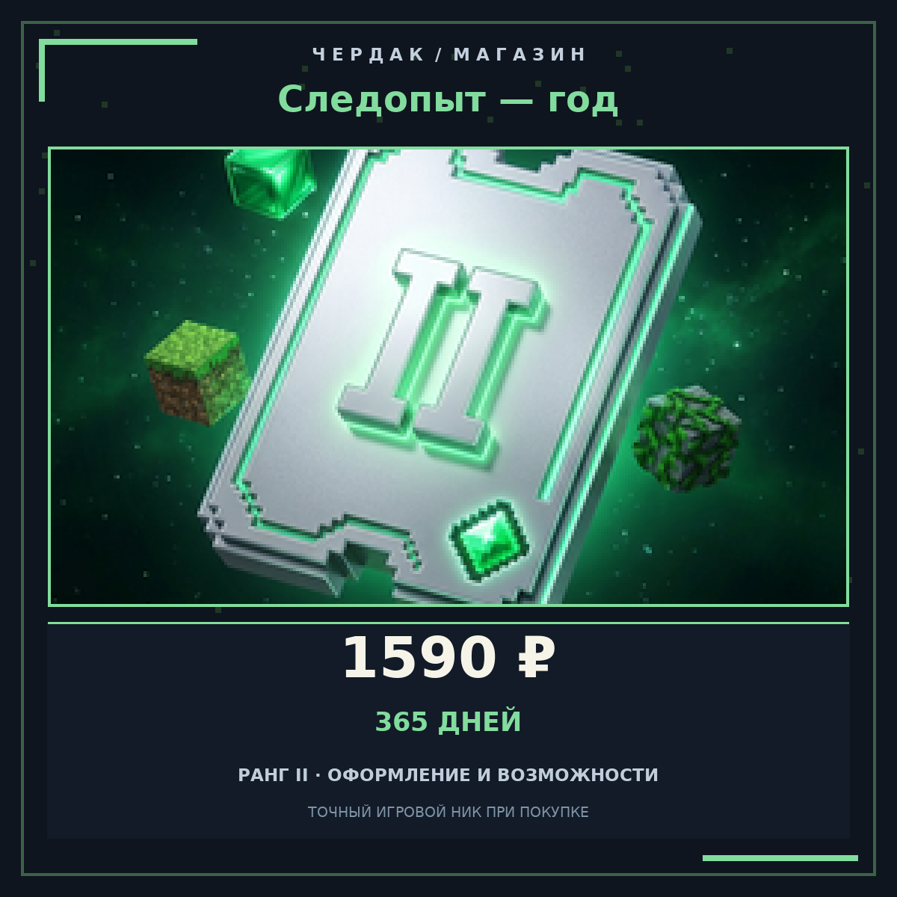

### Описание для товара

- Год Следопыта: 365 дней по цене десяти покупок по 30 дней
- Всё из Странника, 3 шлейфа, +20 % опыта, 6 домов, 34 чанка
- Лимиты: дома — 6; чанки привата — 34; лоты аукциона — 15.
- Скидка на платные телепорты: 20%; цена не ниже 1 алмаза.
- Надписи после ника: 2; сохранённых пресетов: 3. Ник всегда первый и не занимает место.
- Опыт профессий: +20%; потолок профессии: 29 (25 + 4 от ранга).
- Количество добычи в находках и охоте: +10% с округлением вниз; это не гарантированное удвоение каждого блока.
- Вход без очереди в рамках вместимости сервера; оформление и возможности предыдущих ступеней.
- Шлейфы по рангу: Огненный шлейф; Сердечки; Ноты. Одновременно выбирается один.
- Платные цвета ника не входят даже в V: приобретаются отдельно.
- Повторная покупка продлевает срок только если весь оплаченный период помещается в горизонт 365 дней. Младший ранг не заменяет старший; повышение пересчитывает остаток по цене. Невозможная доставка уходит на ручную сверку, а не урезается.

### Основная команда — рекомендуется, RCON

```text
pass shopbuy %username% rank-pathfinder-year
```

### Альтернатива по сумме

**Вместо основной команды, не вместе с ней:**

```text
pass shoppay %username% 1590
```

## 05. Хранитель — 30 дней

- **ID:** `rank-keeper`
- **Цена:** 229 ₽
- **Срок:** 30 дней
- **Картинка:** [05-rank-keeper.png](images/05-rank-keeper.png)

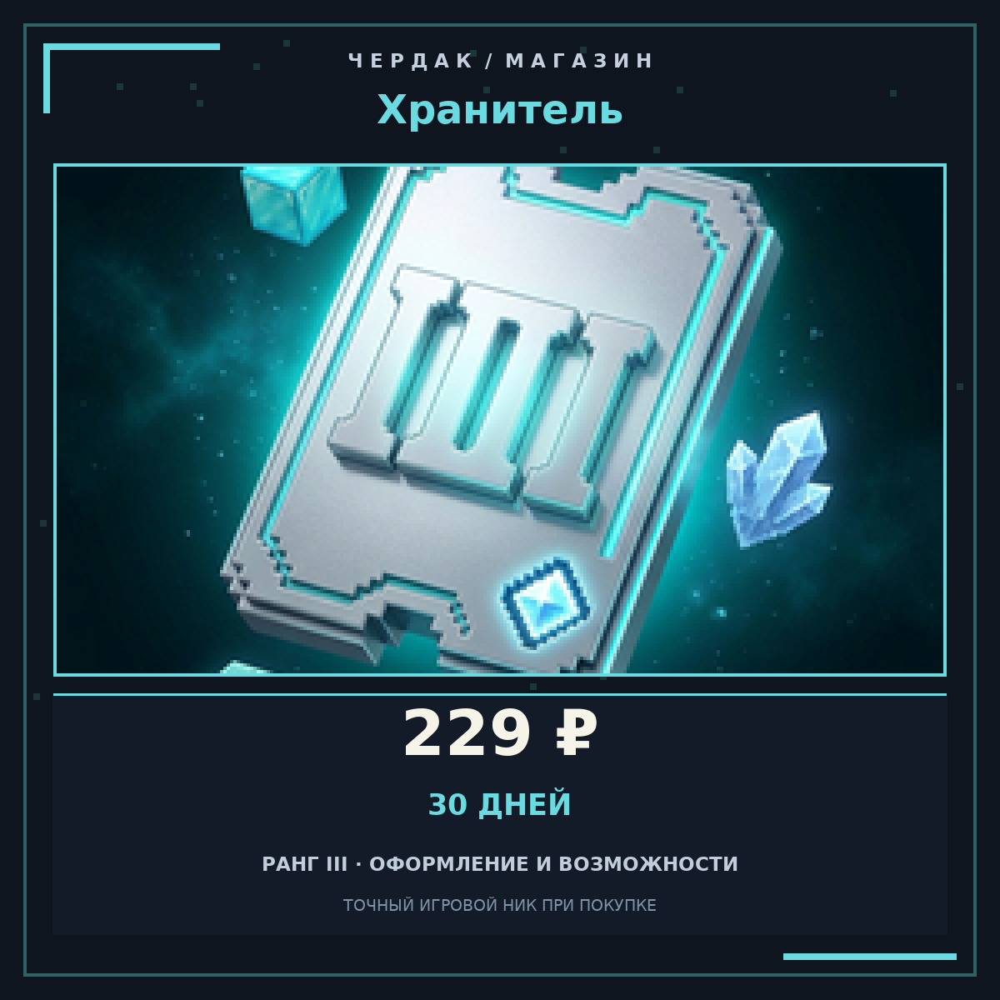

### Описание для товара

- Всё из Следопыта, строка входа, +30 % опыта, +15 % добычи, 8 домов
- Лимиты: дома — 8; чанки привата — 40; лоты аукциона — 18.
- Скидка на платные телепорты: 30%; цена не ниже 1 алмаза.
- Надписи после ника: 3; сохранённых пресетов: 4. Ник всегда первый и не занимает место.
- Опыт профессий: +30%; потолок профессии: 31 (25 + 6 от ранга).
- Количество добычи в находках и охоте: +15% с округлением вниз; это не гарантированное удвоение каждого блока.
- Вход без очереди в рамках вместимости сервера; оформление и возможности предыдущих ступеней.
- Шлейфы по рангу: Огненный шлейф; Сердечки; Ноты; Искры Энда; Ведьмина магия. Одновременно выбирается один.
- Платные цвета ника не входят даже в V: приобретаются отдельно.
- Повторная покупка продлевает срок только если весь оплаченный период помещается в горизонт 365 дней. Младший ранг не заменяет старший; повышение пересчитывает остаток по цене. Невозможная доставка уходит на ручную сверку, а не урезается.

### Основная команда — рекомендуется, RCON

```text
pass shopbuy %username% rank-keeper
```

### Альтернатива по сумме

**Вместо основной команды, не вместе с ней:**

```text
pass shoppay %username% 229
```

## 06. Хранитель — год — 365 дней

- **ID:** `rank-keeper-year`
- **Цена:** 2290 ₽
- **Срок:** 365 дней
- **Картинка:** [06-rank-keeper-year.png](images/06-rank-keeper-year.png)


### Описание для товара

- Год Хранителя: 365 дней по цене десяти покупок по 30 дней
- Всё из Следопыта, строка входа, +30 % опыта, +15 % добычи, 8 домов
- Лимиты: дома — 8; чанки привата — 40; лоты аукциона — 18.
- Скидка на платные телепорты: 30%; цена не ниже 1 алмаза.
- Надписи после ника: 3; сохранённых пресетов: 4. Ник всегда первый и не занимает место.
- Опыт профессий: +30%; потолок профессии: 31 (25 + 6 от ранга).
- Количество добычи в находках и охоте: +15% с округлением вниз; это не гарантированное удвоение каждого блока.
- Вход без очереди в рамках вместимости сервера; оформление и возможности предыдущих ступеней.
- Шлейфы по рангу: Огненный шлейф; Сердечки; Ноты; Искры Энда; Ведьмина магия. Одновременно выбирается один.
- Платные цвета ника не входят даже в V: приобретаются отдельно.
- Повторная покупка продлевает срок только если весь оплаченный период помещается в горизонт 365 дней. Младший ранг не заменяет старший; повышение пересчитывает остаток по цене. Невозможная доставка уходит на ручную сверку, а не урезается.

### Основная команда — рекомендуется, RCON

```text
pass shopbuy %username% rank-keeper-year
```

### Альтернатива по сумме

**Вместо основной команды, не вместе с ней:**

```text
pass shoppay %username% 2290
```

## 07. Меценат — 30 дней

- **ID:** `rank-patron`
- **Цена:** 299 ₽
- **Срок:** 30 дней
- **Картинка:** [07-rank-patron.png](images/07-rank-patron.png)

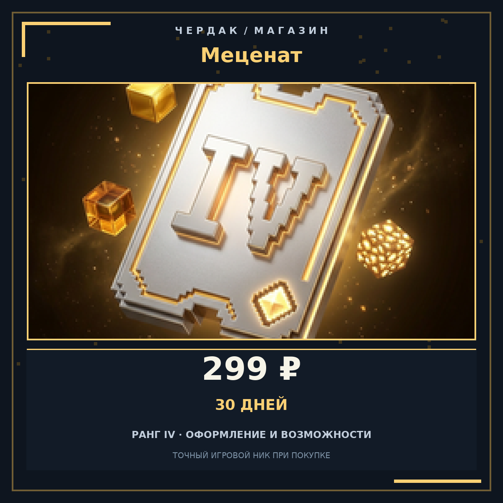

### Описание для товара

- Всё из Хранителя, градиент, свой шлейф, премиум-трек, +40 % опыта
- Лимиты: дома — 10; чанки привата — 44; лоты аукциона — 24.
- Скидка на платные телепорты: 40%; цена не ниже 1 алмаза.
- Надписи после ника: 4; сохранённых пресетов: 5. Ник всегда первый и не занимает место.
- Опыт профессий: +40%; потолок профессии: 33 (25 + 8 от ранга).
- Количество добычи в находках и охоте: +20% с округлением вниз; это не гарантированное удвоение каждого блока.
- Вход без очереди в рамках вместимости сервера; оформление и возможности предыдущих ступеней.
- Шлейфы по рангу: Огненный шлейф; Сердечки; Ноты; Искры Энда; Ведьмина магия; Золотая пыль. Одновременно выбирается один.
- Премиум-трек боевого пропуска и эффект входа доступны, пока активен ранг IV–V.
- Платные цвета ника не входят даже в V: приобретаются отдельно.
- Повторная покупка продлевает срок только если весь оплаченный период помещается в горизонт 365 дней. Младший ранг не заменяет старший; повышение пересчитывает остаток по цене. Невозможная доставка уходит на ручную сверку, а не урезается.

### Основная команда — рекомендуется, RCON

```text
pass shopbuy %username% rank-patron
```

### Альтернатива по сумме

**Вместо основной команды, не вместе с ней:**

```text
pass shoppay %username% 299
```

## 08. Меценат — год — 365 дней

- **ID:** `rank-patron-year`
- **Цена:** 2990 ₽
- **Срок:** 365 дней
- **Картинка:** [08-rank-patron-year.png](images/08-rank-patron-year.png)


### Описание для товара

- Год Мецената: 365 дней по цене десяти покупок по 30 дней
- Всё из Хранителя, градиент, свой шлейф, премиум-трек, +40 % опыта
- Лимиты: дома — 10; чанки привата — 44; лоты аукциона — 24.
- Скидка на платные телепорты: 40%; цена не ниже 1 алмаза.
- Надписи после ника: 4; сохранённых пресетов: 5. Ник всегда первый и не занимает место.
- Опыт профессий: +40%; потолок профессии: 33 (25 + 8 от ранга).
- Количество добычи в находках и охоте: +20% с округлением вниз; это не гарантированное удвоение каждого блока.
- Вход без очереди в рамках вместимости сервера; оформление и возможности предыдущих ступеней.
- Шлейфы по рангу: Огненный шлейф; Сердечки; Ноты; Искры Энда; Ведьмина магия; Золотая пыль. Одновременно выбирается один.
- Премиум-трек боевого пропуска и эффект входа доступны, пока активен ранг IV–V.
- Платные цвета ника не входят даже в V: приобретаются отдельно.
- Повторная покупка продлевает срок только если весь оплаченный период помещается в горизонт 365 дней. Младший ранг не заменяет старший; повышение пересчитывает остаток по цене. Невозможная доставка уходит на ручную сверку, а не урезается.

### Основная команда — рекомендуется, RCON

```text
pass shopbuy %username% rank-patron-year
```

### Альтернатива по сумме

**Вместо основной команды, не вместе с ней:**

```text
pass shoppay %username% 2990
```

## 09. Покровитель — 30 дней

- **ID:** `rank-founder`
- **Цена:** 365 ₽
- **Срок:** 30 дней
- **Картинка:** [09-rank-founder.png](images/09-rank-founder.png)

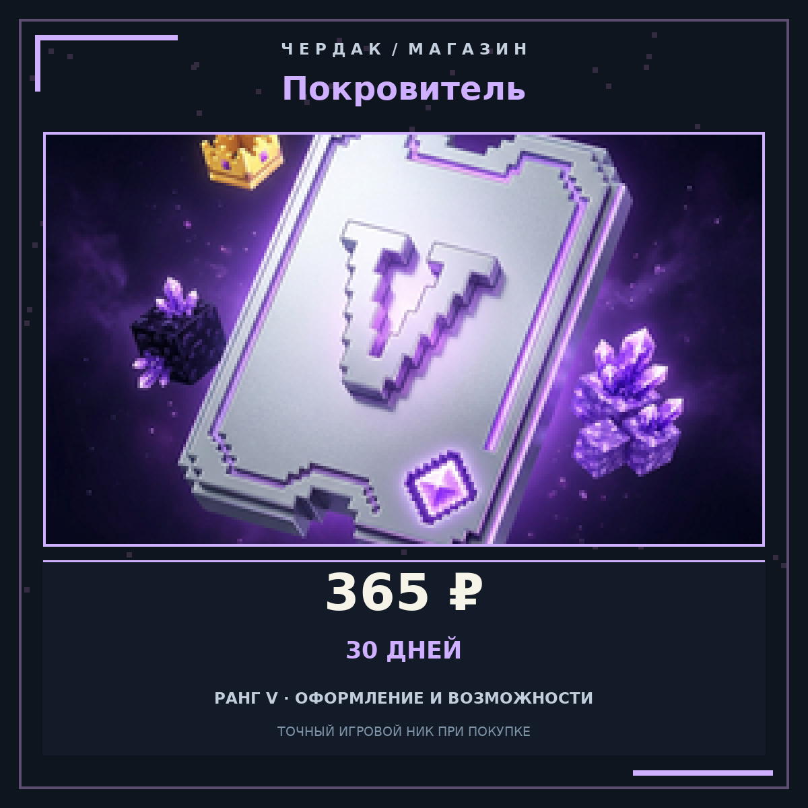

### Описание для товара

- Всё из Мецената, /hat, знак ⚜, +50 % опыта, +25 % добычи, потолок профессии +10
- Лимиты: дома — 12; чанки привата — 48; лоты аукциона — 30.
- Скидка на платные телепорты: 50%; цена не ниже 1 алмаза.
- Надписи после ника: 5; сохранённых пресетов: 6. Ник всегда первый и не занимает место.
- Опыт профессий: +50%; потолок профессии: 35 (25 + 10 от ранга).
- Количество добычи в находках и охоте: +25% с округлением вниз; это не гарантированное удвоение каждого блока.
- Вход без очереди в рамках вместимости сервера; оформление и возможности предыдущих ступеней.
- Шлейфы по рангу: Огненный шлейф; Сердечки; Ноты; Искры Энда; Ведьмина магия; Золотая пыль; Сияние. Одновременно выбирается один.
- Премиум-трек боевого пропуска и эффект входа доступны, пока активен ранг IV–V.
- Команда /hat (предмет в руке на голову); шлейф «Сияние».
- Платные цвета ника не входят даже в V: приобретаются отдельно.
- Повторная покупка продлевает срок только если весь оплаченный период помещается в горизонт 365 дней. Младший ранг не заменяет старший; повышение пересчитывает остаток по цене. Невозможная доставка уходит на ручную сверку, а не урезается.

### Основная команда — рекомендуется, RCON

```text
pass shopbuy %username% rank-founder
```

### Альтернатива по сумме

**Вместо основной команды, не вместе с ней:**

```text
pass shoppay %username% 365
```

## 10. Покровитель — год — 365 дней

- **ID:** `rank-founder-year`
- **Цена:** 3650 ₽
- **Срок:** 365 дней
- **Картинка:** [10-rank-founder-year.png](images/10-rank-founder-year.png)

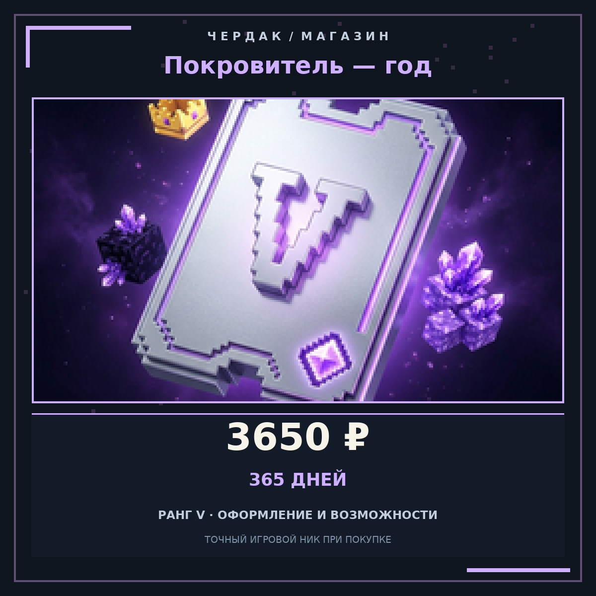

### Описание для товара

- Год Покровителя — вершина лестницы: 3650 ₽, все бонусы максимума
- Всё из Мецената, /hat, знак ⚜, +50 % опыта, +25 % добычи, потолок профессии +10
- Лимиты: дома — 12; чанки привата — 48; лоты аукциона — 30.
- Скидка на платные телепорты: 50%; цена не ниже 1 алмаза.
- Надписи после ника: 5; сохранённых пресетов: 6. Ник всегда первый и не занимает место.
- Опыт профессий: +50%; потолок профессии: 35 (25 + 10 от ранга).
- Количество добычи в находках и охоте: +25% с округлением вниз; это не гарантированное удвоение каждого блока.
- Вход без очереди в рамках вместимости сервера; оформление и возможности предыдущих ступеней.
- Шлейфы по рангу: Огненный шлейф; Сердечки; Ноты; Искры Энда; Ведьмина магия; Золотая пыль; Сияние. Одновременно выбирается один.
- Премиум-трек боевого пропуска и эффект входа доступны, пока активен ранг IV–V.
- Команда /hat (предмет в руке на голову); шлейф «Сияние».
- Платные цвета ника не входят даже в V: приобретаются отдельно.
- Повторная покупка продлевает срок только если весь оплаченный период помещается в горизонт 365 дней. Младший ранг не заменяет старший; повышение пересчитывает остаток по цене. Невозможная доставка уходит на ручную сверку, а не урезается.

### Основная команда — рекомендуется, RCON

```text
pass shopbuy %username% rank-founder-year
```

### Альтернатива по сумме

**Вместо основной команды, не вместе с ней:**

```text
pass shoppay %username% 3650
```

## 11. Дома: +8 точек — 30 дней

- **ID:** `homes-plus`
- **Цена:** 109 ₽
- **Срок:** 30 дней
- **Картинка:** [11-homes-plus.png](images/11-homes-plus.png)

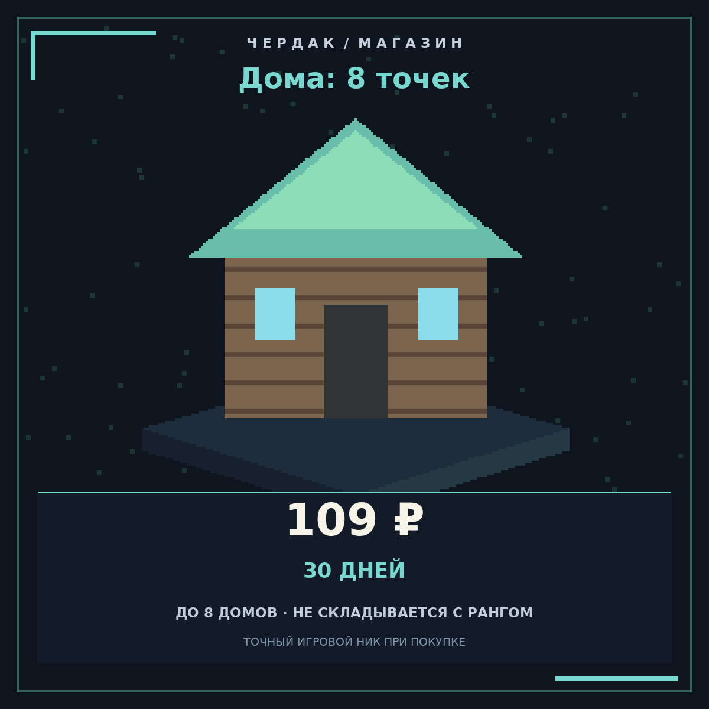

### Описание для товара

- +8 точек дома на 30 дней за каждую покупку; складываются с рангом и другими активными пакетами, без общего потолка
- Каждая покупка добавляет +8 мест на собственные 30 дней; повторная покупка не продлевает старый пакет.
- Складывается с базой ранга и всеми активными пакетами, без общего игрового потолка. Ранг V + два пакета = 12 + 8 + 8 = 28 домов.
- Количество пакетов учитывает ядро, не право LuckPerms. При истечении купленных мест сохранённые точки не удаляются.

### Основная команда — рекомендуется, RCON

```text
pass shopbuy %username% homes-plus
```

### Альтернатива по сумме

**Вместо основной команды, не вместе с ней:**

```text
pass shoppay %username% 109
```

## 12. Огненный шлейф — 30 дней

- **ID:** `trail-flame`
- **Цена:** 39 ₽
- **Срок:** 30 дней
- **Картинка:** [12-trail-flame.png](images/12-trail-flame.png)

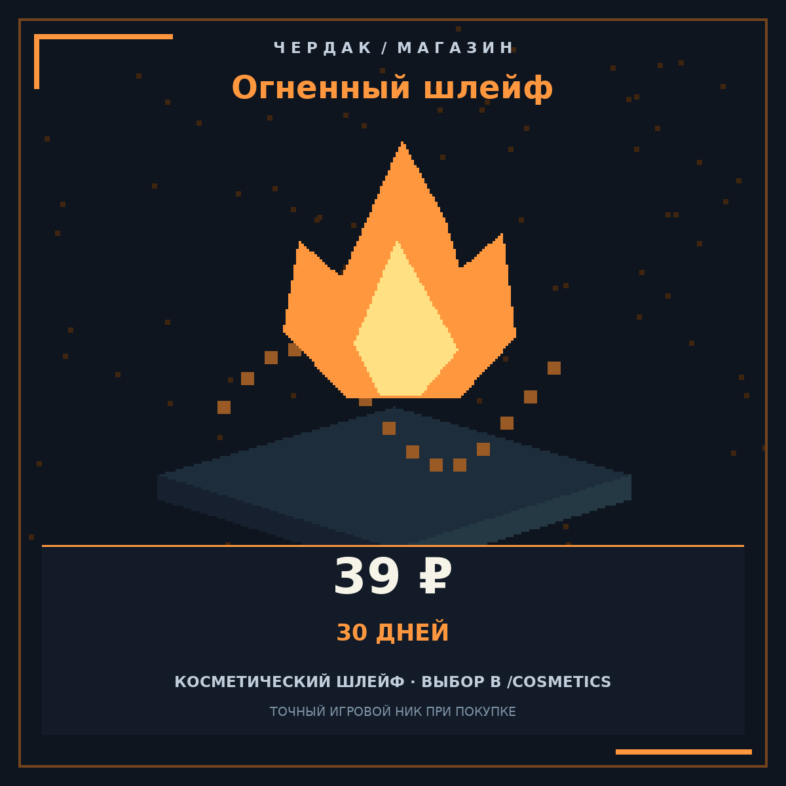

### Описание для товара

- Шлейф огня за спиной — 30 дней
- Выбор эффекта: /cosmetics. Одновременно используется один шлейф; можно отключить.
- Повторная покупка добавляет срок к остатку, не усиливает эффект. Потолок 365 дней: если весь оплаченный срок не помещается, доставка не выполняется и требует ручной сверки с магазином.

### Основная команда — рекомендуется, RCON

```text
pass shopbuy %username% trail-flame
```

### Альтернатива по сумме

**Вместо основной команды, не вместе с ней:**

```text
pass shoppay %username% 39
```

## 13. Сердечки — 30 дней

- **ID:** `trail-hearts`
- **Цена:** 49 ₽
- **Срок:** 30 дней
- **Картинка:** [13-trail-hearts.png](images/13-trail-hearts.png)

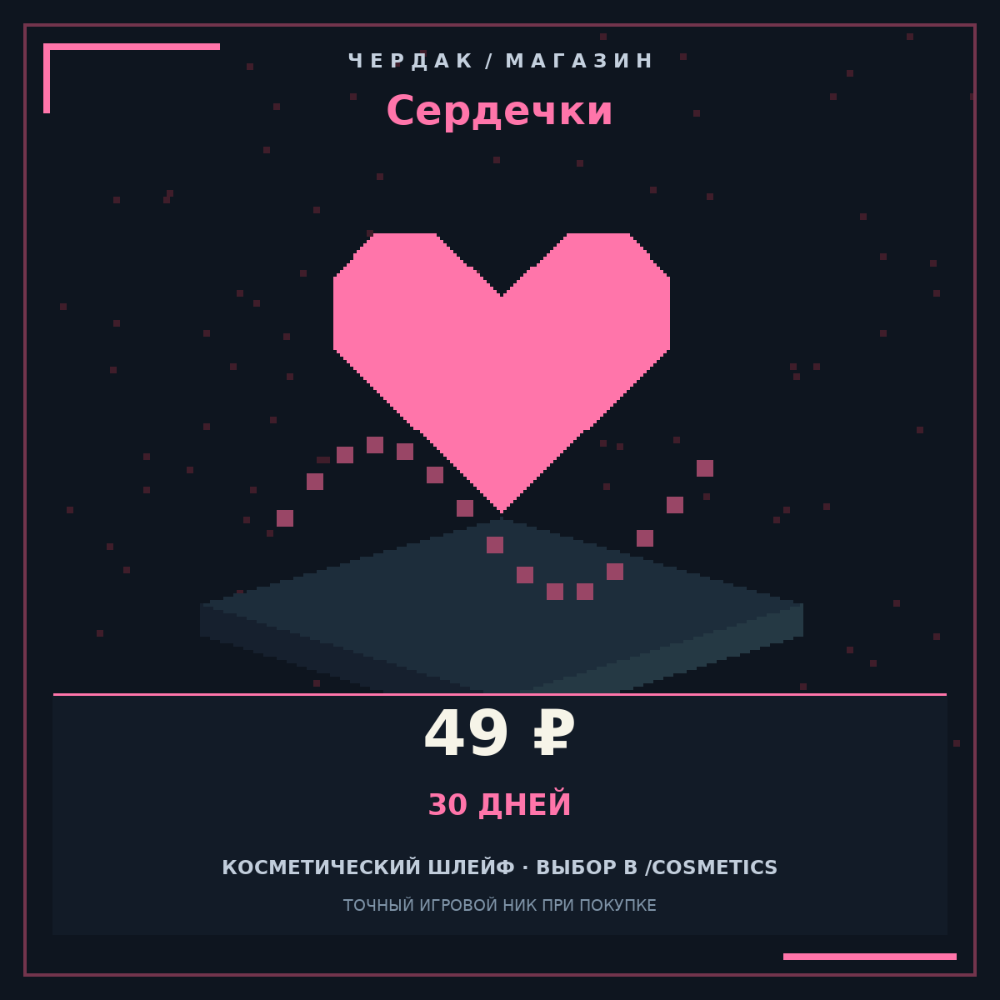

### Описание для товара

- Шлейф сердечек за спиной — 30 дней
- Выбор эффекта: /cosmetics. Одновременно используется один шлейф; можно отключить.
- Повторная покупка добавляет срок к остатку, не усиливает эффект. Потолок 365 дней: если весь оплаченный срок не помещается, доставка не выполняется и требует ручной сверки с магазином.

### Основная команда — рекомендуется, RCON

```text
pass shopbuy %username% trail-hearts
```

### Альтернатива по сумме

**Вместо основной команды, не вместе с ней:**

```text
pass shoppay %username% 49
```

## 14. Ноты — 30 дней

- **ID:** `trail-notes`
- **Цена:** 59 ₽
- **Срок:** 30 дней
- **Картинка:** [14-trail-notes.png](images/14-trail-notes.png)

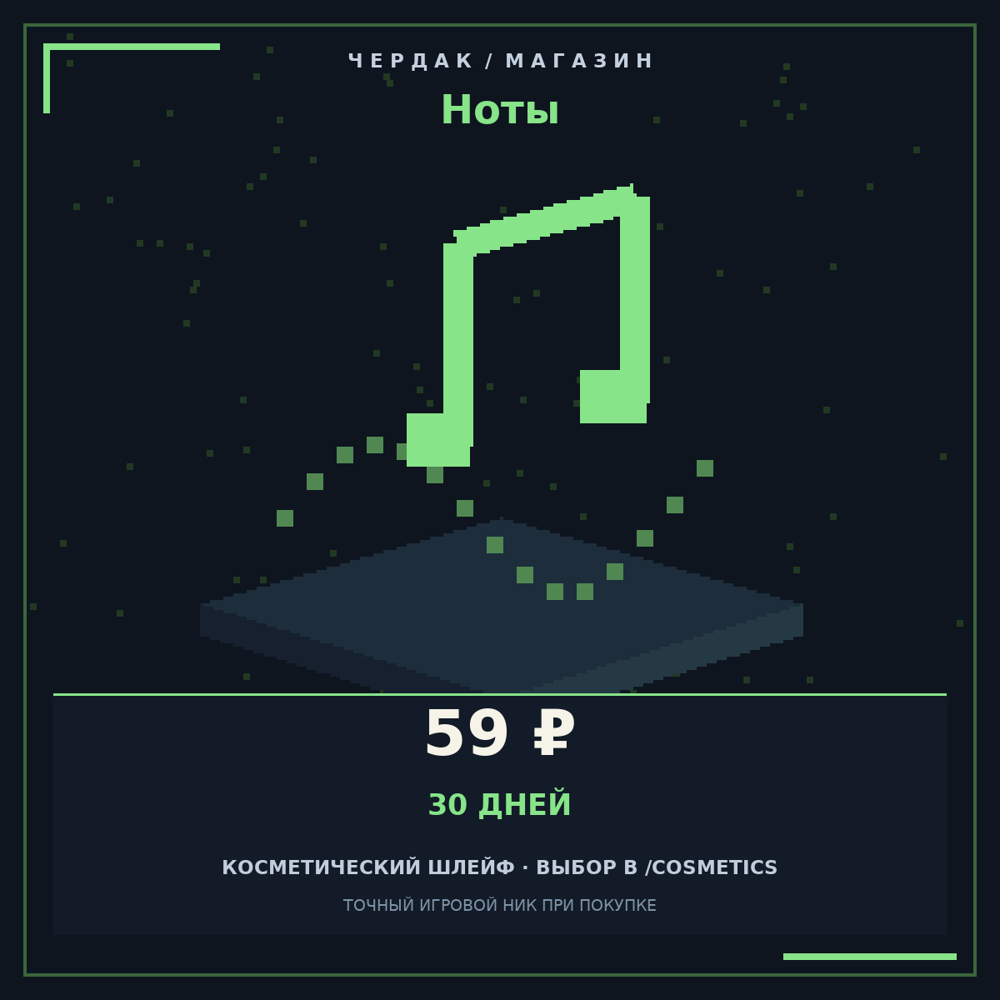

### Описание для товара

- Шлейф нот за спиной — 30 дней
- Выбор эффекта: /cosmetics. Одновременно используется один шлейф; можно отключить.
- Повторная покупка добавляет срок к остатку, не усиливает эффект. Потолок 365 дней: если весь оплаченный срок не помещается, доставка не выполняется и требует ручной сверки с магазином.

### Основная команда — рекомендуется, RCON

```text
pass shopbuy %username% trail-notes
```

### Альтернатива по сумме

**Вместо основной команды, не вместе с ней:**

```text
pass shoppay %username% 59
```

## 15. Искры Энда — 30 дней

- **ID:** `trail-sparkles`
- **Цена:** 69 ₽
- **Срок:** 30 дней
- **Картинка:** [15-trail-sparkles.png](images/15-trail-sparkles.png)

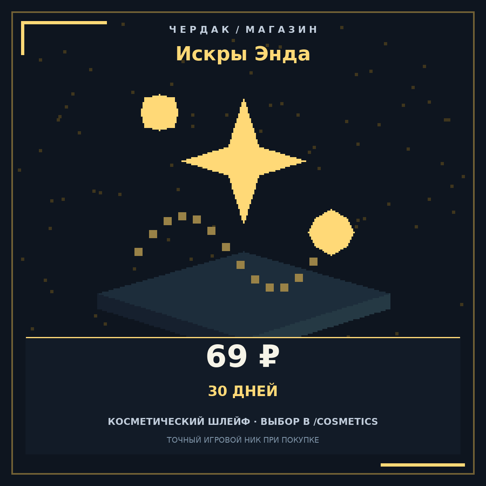

### Описание для товара

- Шлейф искр Энда за спиной — 30 дней
- Выбор эффекта: /cosmetics. Одновременно используется один шлейф; можно отключить.
- Повторная покупка добавляет срок к остатку, не усиливает эффект. Потолок 365 дней: если весь оплаченный срок не помещается, доставка не выполняется и требует ручной сверки с магазином.

### Основная команда — рекомендуется, RCON

```text
pass shopbuy %username% trail-sparkles
```

### Альтернатива по сумме

**Вместо основной команды, не вместе с ней:**

```text
pass shoppay %username% 69
```

## 16. Ведьмина магия — 30 дней

- **ID:** `trail-magic`
- **Цена:** 79 ₽
- **Срок:** 30 дней
- **Картинка:** [16-trail-magic.png](images/16-trail-magic.png)

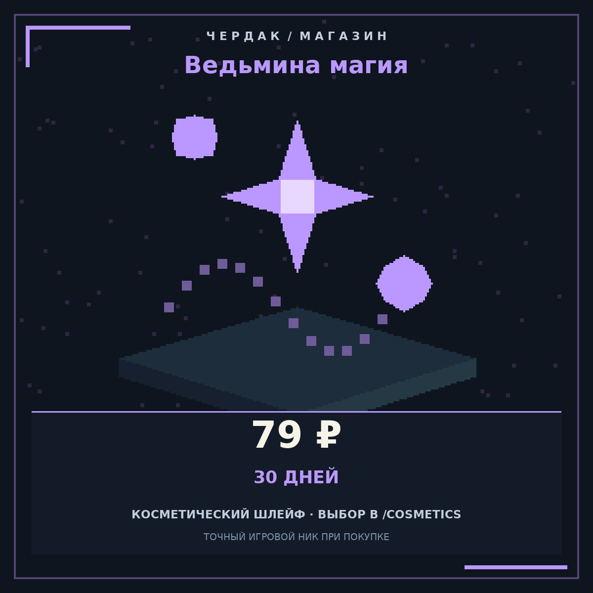

### Описание для товара

- Шлейф ведьминой магии за спиной — 30 дней
- Выбор эффекта: /cosmetics. Одновременно используется один шлейф; можно отключить.
- Повторная покупка добавляет срок к остатку, не усиливает эффект. Потолок 365 дней: если весь оплаченный срок не помещается, доставка не выполняется и требует ручной сверки с магазином.

### Основная команда — рекомендуется, RCON

```text
pass shopbuy %username% trail-magic
```

### Альтернатива по сумме

**Вместо основной команды, не вместе с ней:**

```text
pass shoppay %username% 79
```

## 17. Торжественный вход — 30 дней

- **ID:** `join-effect`
- **Цена:** 89 ₽
- **Срок:** 30 дней
- **Картинка:** [17-join-effect.png](images/17-join-effect.png)

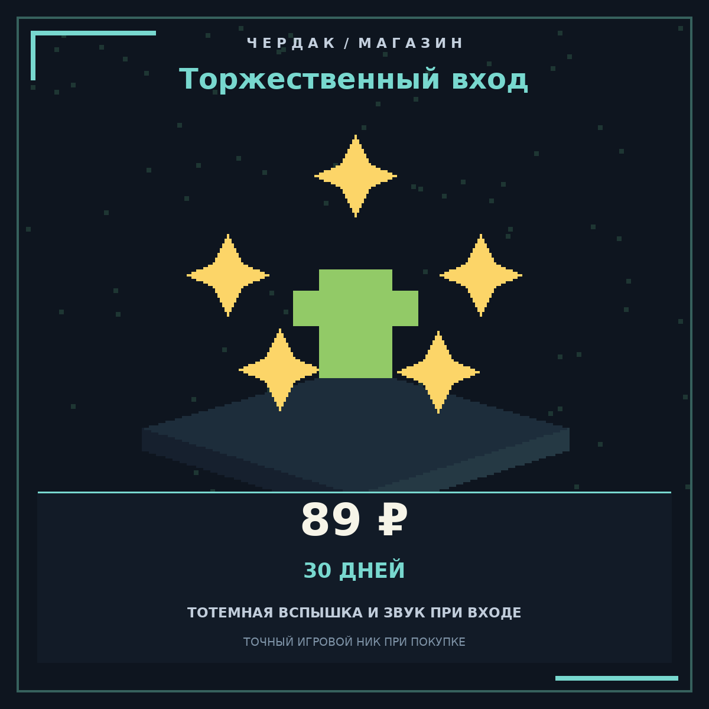

### Описание для товара

- Вспышка тотема и звук при входе на сервер — 30 дней
- Включается автоматически при следующем входе, пока активна покупка или ранг IV–V.
- Отдельного переключателя этого эффекта в /cosmetics нет: команда управляет только шлейфом.
- Повторная покупка добавляет срок к остатку, не усиливает эффект. Потолок 365 дней: если весь оплаченный срок не помещается, доставка не выполняется и требует ручной сверки с магазином.

### Основная команда — рекомендуется, RCON

```text
pass shopbuy %username% join-effect
```

### Альтернатива по сумме

**Вместо основной команды, не вместе с ней:**

```text
pass shoppay %username% 89
```

## 18. Цвет ника: Сияние — 30 дней

- **ID:** `nick-aurora`
- **Цена:** 119 ₽
- **Срок:** 30 дней
- **Картинка:** [18-nick-aurora.png](images/18-nick-aurora.png)

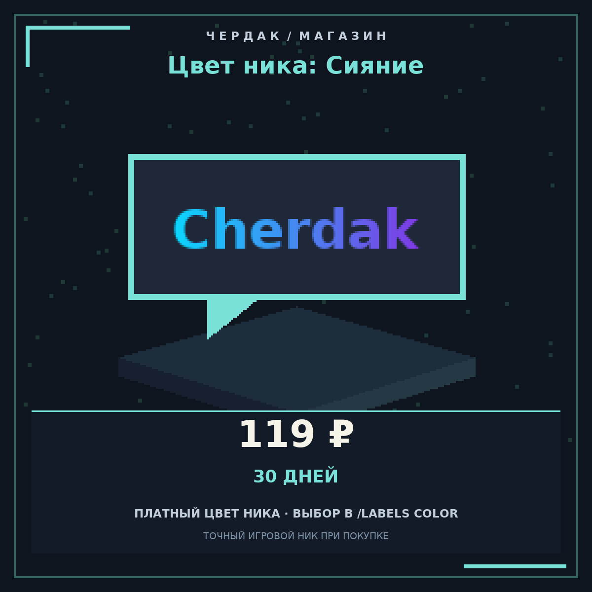

### Описание для товара

- Градиент «Сияние» для ника — 30 дней
- Прямой выбор купленного цвета: /labels color aurora.
- Выбор в /labels color или /profile → Надписи. Нужна отдельная реальная покупка этого цвета.
- Покупка цвета не добавляет шлейф, эффект входа, ранг или игровые бонусы. По окончании срока платный цвет недоступен, даже если выбран в сохранённом пресете.
- Повторная покупка добавляет срок к остатку, не усиливает эффект. Потолок 365 дней: если весь оплаченный срок не помещается, доставка не выполняется и требует ручной сверки с магазином.

### Основная команда — рекомендуется, RCON

```text
pass shopbuy %username% nick-aurora
```

### Альтернатива по сумме

**Вместо основной команды, не вместе с ней:**

```text
pass shoppay %username% 119
```

## 19. Цвет ника: Пламя — 30 дней

- **ID:** `nick-flame`
- **Цена:** 129 ₽
- **Срок:** 30 дней
- **Картинка:** [19-nick-flame.png](images/19-nick-flame.png)

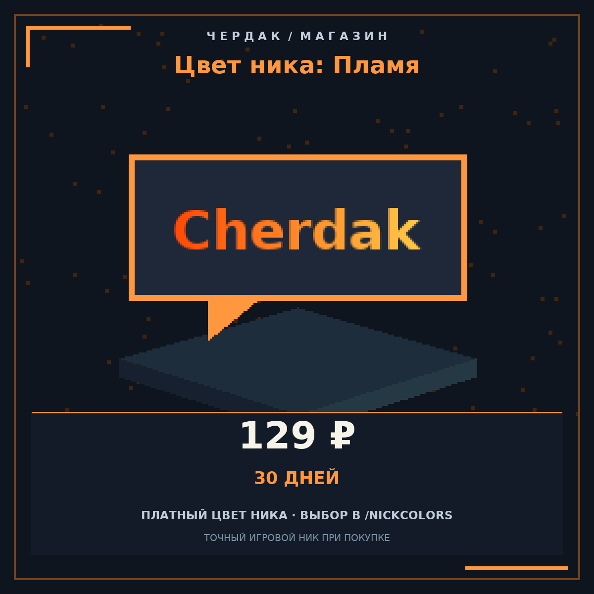

### Описание для товара

- Градиент «Пламя» для ника — 30 дней
- Прямой выбор купленного цвета: /labels color flame.
- Выбор в /labels color или /profile → Надписи. Нужна отдельная реальная покупка этого цвета.
- Покупка цвета не добавляет шлейф, эффект входа, ранг или игровые бонусы. По окончании срока платный цвет недоступен, даже если выбран в сохранённом пресете.
- Повторная покупка добавляет срок к остатку, не усиливает эффект. Потолок 365 дней: если весь оплаченный срок не помещается, доставка не выполняется и требует ручной сверки с магазином.

### Основная команда — рекомендуется, RCON

```text
pass shopbuy %username% nick-flame
```

### Альтернатива по сумме

**Вместо основной команды, не вместе с ней:**

```text
pass shoppay %username% 129
```

## 20. Цвет ника: Жемчуг — 30 дней

- **ID:** `nick-pearl`
- **Цена:** 139 ₽
- **Срок:** 30 дней
- **Картинка:** [20-nick-pearl.png](images/20-nick-pearl.png)

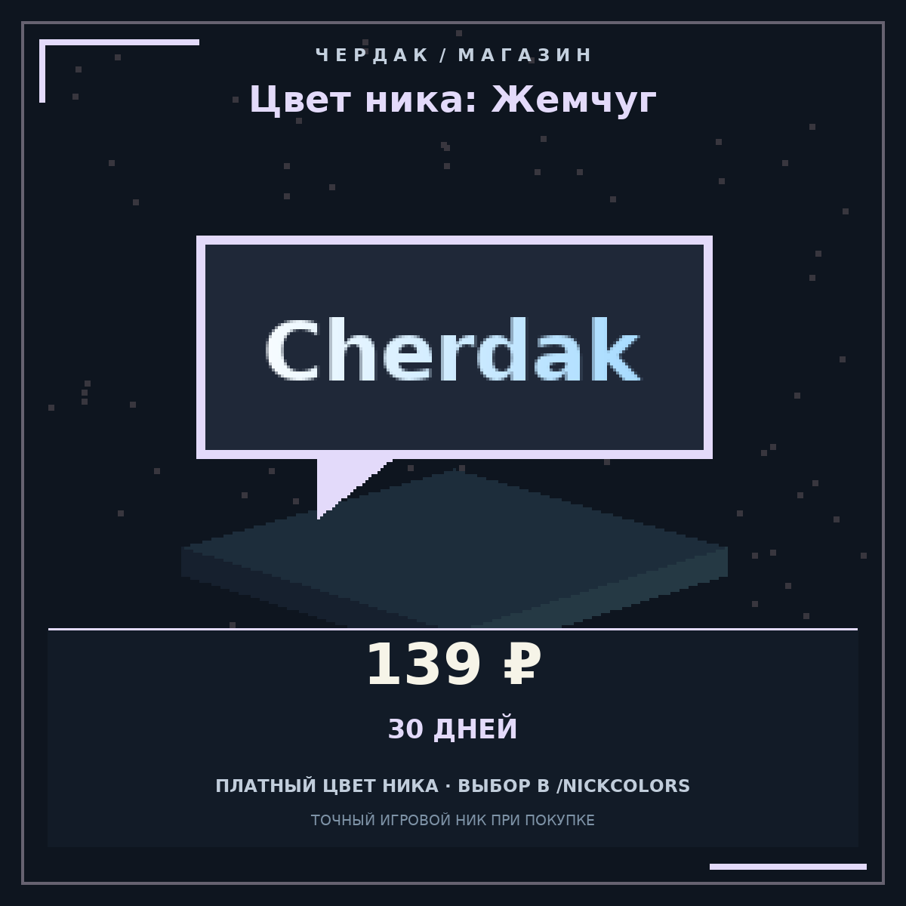

### Описание для товара

- Градиент «Жемчуг» для ника — 30 дней
- Прямой выбор купленного цвета: /labels color pearl.
- Выбор в /labels color или /profile → Надписи. Нужна отдельная реальная покупка этого цвета.
- Покупка цвета не добавляет шлейф, эффект входа, ранг или игровые бонусы. По окончании срока платный цвет недоступен, даже если выбран в сохранённом пресете.
- Повторная покупка добавляет срок к остатку, не усиливает эффект. Потолок 365 дней: если весь оплаченный срок не помещается, доставка не выполняется и требует ручной сверки с магазином.

### Основная команда — рекомендуется, RCON

```text
pass shopbuy %username% nick-pearl
```

### Альтернатива по сумме

**Вместо основной команды, не вместе с ней:**

```text
pass shoppay %username% 139
```

## 21. Цвет ника: Лагуна — 30 дней

- **ID:** `nick-lagoon`
- **Цена:** 149 ₽
- **Срок:** 30 дней
- **Картинка:** [21-nick-lagoon.png](images/21-nick-lagoon.png)

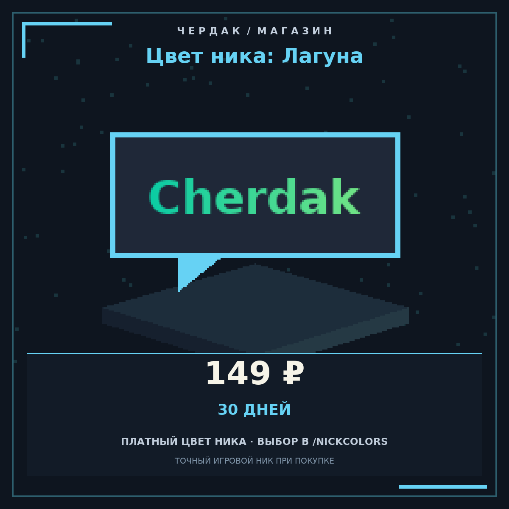

### Описание для товара

- Градиент «Лагуна» для ника — 30 дней
- Прямой выбор купленного цвета: /labels color lagoon.
- Выбор в /labels color или /profile → Надписи. Нужна отдельная реальная покупка этого цвета.
- Покупка цвета не добавляет шлейф, эффект входа, ранг или игровые бонусы. По окончании срока платный цвет недоступен, даже если выбран в сохранённом пресете.
- Повторная покупка добавляет срок к остатку, не усиливает эффект. Потолок 365 дней: если весь оплаченный срок не помещается, доставка не выполняется и требует ручной сверки с магазином.

### Основная команда — рекомендуется, RCON

```text
pass shopbuy %username% nick-lagoon
```

### Альтернатива по сумме

**Вместо основной команды, не вместе с ней:**

```text
pass shoppay %username% 149
```

## 22. Цвет ника: Багрянец — 30 дней

- **ID:** `nick-crimson`
- **Цена:** 169 ₽
- **Срок:** 30 дней
- **Картинка:** [22-nick-crimson.png](images/22-nick-crimson.png)

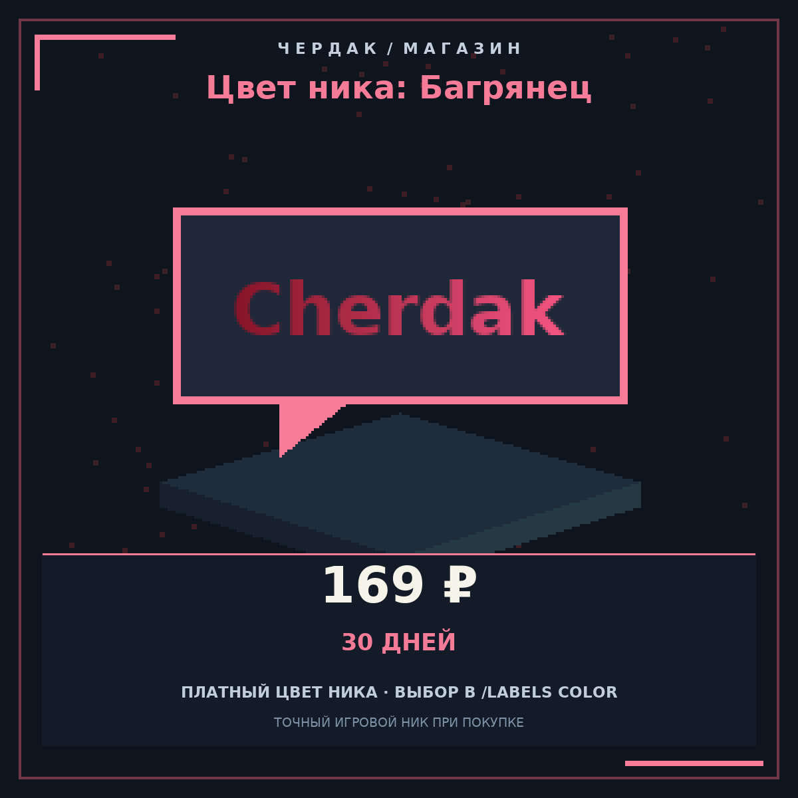

### Описание для товара

- Градиент «Багрянец» для ника — 30 дней
- Прямой выбор купленного цвета: /labels color crimson.
- Выбор в /labels color или /profile → Надписи. Нужна отдельная реальная покупка этого цвета.
- Покупка цвета не добавляет шлейф, эффект входа, ранг или игровые бонусы. По окончании срока платный цвет недоступен, даже если выбран в сохранённом пресете.
- Повторная покупка добавляет срок к остатку, не усиливает эффект. Потолок 365 дней: если весь оплаченный срок не помещается, доставка не выполняется и требует ручной сверки с магазином.

### Основная команда — рекомендуется, RCON

```text
pass shopbuy %username% nick-crimson
```

### Альтернатива по сумме

**Вместо основной команды, не вместе с ней:**

```text
pass shoppay %username% 169
```

## 23. Боевой пропуск — 90 дней

- **ID:** `battlepass-premium`
- **Цена:** 249 ₽
- **Срок:** 90 дней
- **Картинка:** [23-battlepass-premium.png](images/23-battlepass-premium.png)

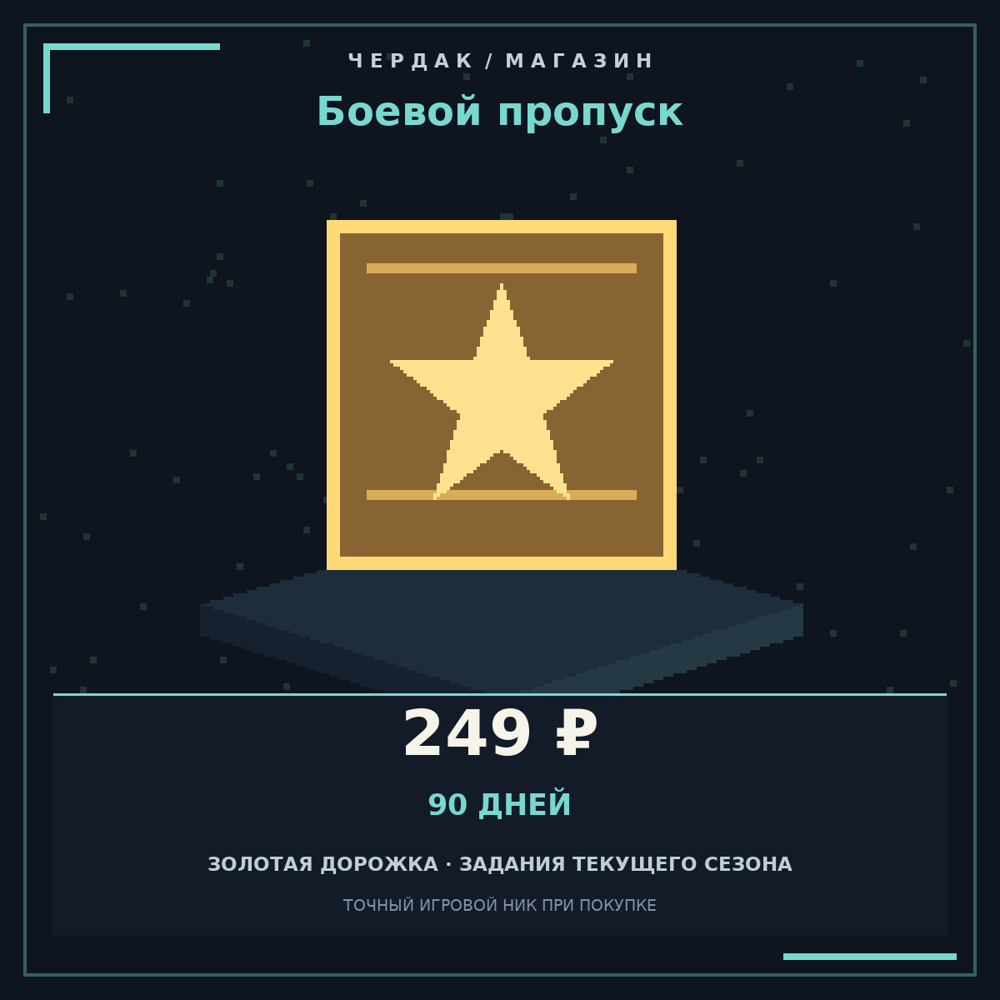

### Описание для товара

- Золотые награды всех заданий сезона: часы отдельного буста
- Открывает золотую дорожку доступных заданий на 90 дней; задания всё равно нужно выполнять. Это срок доступа, не обещание длины сезона и не покупка уровней.
- Награды прогресса — отдельные XP-бусты, а не выдача/продление ранга или других платных товаров. Запас буста по умолчанию 24 часа: расходуйте его перед забором новых наград.
- Ранг IV–V уже открывает этот трек на время действия ранга; отдельная покупка не обязательна.
- Повторная покупка добавляет срок к остатку, не усиливает эффект. Потолок 365 дней: если весь оплаченный срок не помещается, доставка не выполняется и требует ручной сверки с магазином.

### Основная команда — рекомендуется, RCON

```text
pass shopbuy %username% battlepass-premium
```

### Альтернатива по сумме

**Вместо основной команды, не вместе с ней:**

```text
pass shoppay %username% 249
```

## 24. Набор шлейфов — 30 дней

- **ID:** `trails-pack`
- **Цена:** 199 ₽
- **Срок:** 30 дней
- **Картинка:** [24-trails-pack.png](images/24-trails-pack.png)

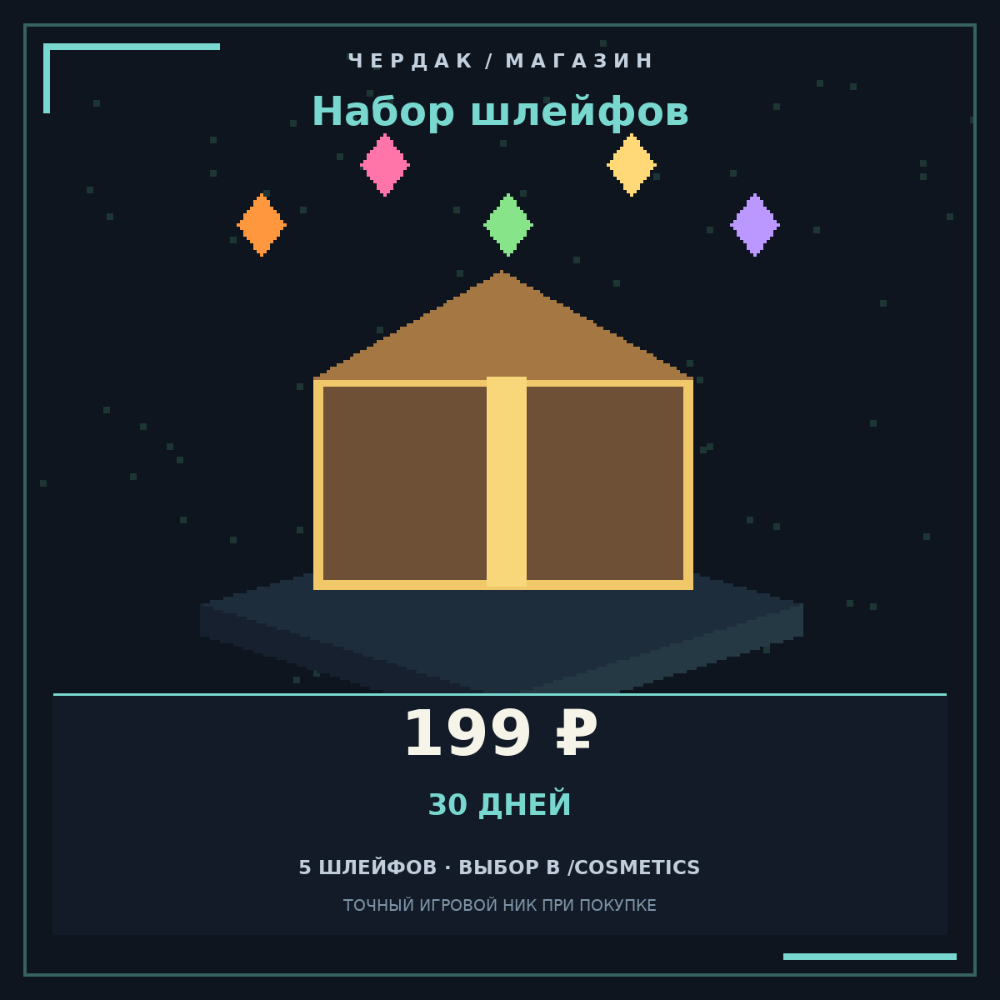

### Описание для товара

- Все пять каталожных шлейфов сразу — вместо 295 ₽, выгода 96 ₽
- Состав: Огненный шлейф; Сердечки; Ноты; Искры Энда; Ведьмина магия.
- Каталожные шлейфы — только пять продаваемых; «Золотая пыль» и ранговое «Сияние» не входят.
- Уже купленные составляющие продлеваются отдельно; итоговые даты могут различаться. Если хотя бы одна часть не помещается в потолок, весь набор отправляется на ручную сверку без частичной выдачи.
- Один платёж — одна команда набора. Не добавляйте отдельные команды его составляющих.

### Основная команда — рекомендуется, RCON

```text
pass shopbuy %username% trails-pack
```

### Альтернатива по сумме

**Вместо основной команды, не вместе с ней:**

```text
pass shoppay %username% 199
```

## 25. Весь вид — 30 дней

- **ID:** `look-pack`
- **Цена:** 599 ₽
- **Срок:** 30 дней
- **Картинка:** [25-look-pack.png](images/25-look-pack.png)

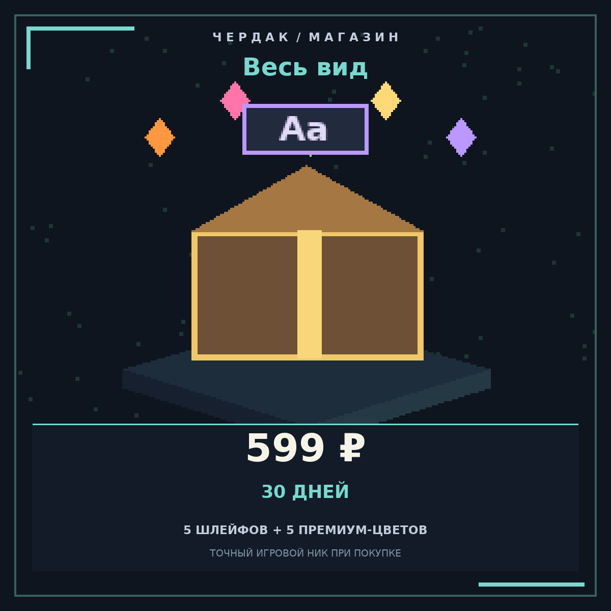

### Описание для товара

- Пять каталожных шлейфов и пять градиентов на 30 дней; поштучно 1 000 ₽, через набор шлейфов 904 ₽
- Состав: Набор шлейфов; Цвет ника: Сияние; Цвет ника: Пламя; Цвет ника: Жемчуг; Цвет ника: Лагуна; Цвет ника: Багрянец.
- Каталожные шлейфы — только пять продаваемых; «Золотая пыль» и ранговое «Сияние» не входят.
- Уже купленные составляющие продлеваются отдельно; итоговые даты могут различаться. Если хотя бы одна часть не помещается в потолок, весь набор отправляется на ручную сверку без частичной выдачи.
- Один платёж — одна команда набора. Не добавляйте отдельные команды его составляющих.
- Поштучно: 1 000 ₽; пять цветов + набор шлейфов: 904 ₽. Цена 599 ₽ экономит 305 ₽ относительно второго способа (401 ₽ относительно поштучного).
- Всего пять шлейфов и пять премиум-цветов. Ранг и эффект входа не входят.

### Основная команда — рекомендуется, RCON

```text
pass shopbuy %username% look-pack
```

### Альтернатива по сумме

**Вместо основной команды, не вместе с ней:**

```text
pass shoppay %username% 599
```

## 26. Всё включено — 30 дней

- **ID:** `all-inclusive`
- **Цена:** 899 ₽
- **Срок:** 30 дней
- **Картинка:** [26-all-inclusive.png](images/26-all-inclusive.png)


### Описание для товара

- Покровитель V, +8 домов, пять шлейфов, пять платных цветов, эффект входа и премиум-трек — на 30 дней
- Состав: Покровитель V, один пакет +8 домов, пять каталожных шлейфов, пять платных цветов ника, эффект входа и премиум-трек боевого пропуска.
- Все составляющие этой покупки — на 30 дней. Отдельный боевой пропуск за 249 ₽ остаётся товаром на 90 дней.
- На стандартных настройках первый набор даёт 12 + 8 = 20 домов. Ранее купленные активные пакеты +8 также складываются, без общего игрового потолка.
- Повторная покупка продлевает ранг и косметику на 30 дней, но добавляет новый пакет домов на собственные 30 дней. Итоговые даты старых и новых прав могут различаться.
- V также открывает два эксклюзивных ранговых шлейфа; одновременно выбирается один эффект. Выбор цвета — /labels color, шлейфа — /cosmetics, входной эффект автоматический.
- По отдельности Покровитель 365 ₽ + «Весь вид» 599 ₽ + дома 109 ₽ = 1 073 ₽ за те же возможности на 30 дней; экономия набора 174 ₽. Премиум-трек и вход уже доступны по V, их цена повторно не прибавляется.
- Постоянному Покровителю V набор не выдаётся. Если ранг или хоть одно дополнение не проходит проверку срока, весь набор требует ручной сверки; частичной выдачи нет.
- Существующие покупки не заменяются и не урезаются. Горизонт ранга/продлений — 365 дней. Условия бонуса Boosty — общие, только при включении/подтверждении.
- Это одна оплаченная покупка. В карточку добавьте только одну основную команду, не команды составляющих. Возвраты набора с рангом разбираются вручную.

### Основная команда — рекомендуется, RCON

```text
pass shopbuy %username% all-inclusive
```

### Альтернатива по сумме

**Вместо основной команды, не вместе с ней:**

```text
pass shoppay %username% 899
```

## Дополнительные команды и примечания для владельца

```text
pass shopgift <ник_получателя> <id_товара> [ник_дарителя]
```

Оплаченный подарок через доверенную RCON-доставку. Уголки и квадратные скобки
показывают синтаксис, а не готовую строку панели. Не выдумывайте подстановки:
панель должна уметь передавать отдельные поля получателя и дарителя. Если таких
полей нет, покупатель просто указывает ник друга как игровой ник обычного товара
и используется основная shopbuy-команда. Отдельная команда подарка не нужна.

```text
pass shopbuy <ник> <id_товара> [дни] payment=<реальный_номер_платежа>
pass shoppay <ник> <сумма> payment=<реальный_номер_платежа>
pass shopgift <ник_получателя> <id_товара> [ник_дарителя] payment=<реальный_номер_платежа>
```

Только для РУЧНОЙ серверной консоли с настоящим подтверждением оплаты.
Не включать эти шаблоны в карточки TradeMC без номера заказа. Не придумывать
payment= и не добавлять свой срок в стандартные карточки: там срок из каталога.
Сумма и срок при ручном подтверждении должны соответствовать каталогу.

```text
pass paidaudit
```

Только уполномоченный администратор: отчёт по оплатам/доставкам и историческим
платным правам; не меняет покупки и ничего не отзывает. Сверяйте с кабинетом магазина.
```text
pass luckperms setup
```

Однократная настройка групп сервером с LuckPerms; это не команда продажи.
Купленные дома учитываются ядром независимо от наличия LP и его прав.

### Команды для игрока (с / в игровом чате; НЕ добавлять в доставку TradeMC)

- `/rank my` — активный ранг и срок; `/rank shop` — витрина; `/rank top` — топ IV–V.
- `/cosmetics` — выбор/отключение шлейфа; эффект входа автоматический, здесь не отключается.
- `/labels color` — выбор купленного цвета ника; `/profile` — оформление и надписи.
- `/bp` — сезонные задания и доступные награды боевого пропуска.
- `/hat` — предмет в руке на голову, доступен только рангу V.

Проверка перед открытием продаж: резервная копия → установка плагинов из одного
релиза → сверка настроек и цен → защищённый RCON → отдельная согласованная покупка
→ один вызов команды → проверка выдачи/срока → сверка журнала с магазином.
Если доставка отклонена по TIME_LIMIT, RANK_HIGHER или INVALID_BUNDLE, запись
попадает в pass pending. Это запрос ручной сверки, не доказательство оплаты:
сверьте кабинет и журнал, затем решите вопрос возврата или выдачи. Не подтверждайте
запись вслепую: команда approve не является повторной выдачей конкретного товара.
Пакеты не выдаются частично; оплаченные дни не срезаются до потолка.
При включённой платной Boosty-подписке бонусные дни зависят от настроек и остатка
до потолка; это не скидка цены TradeMC и не обещание бонуса поверх 365 дней.
Игроку не выдавайте административные права или права на shopbuy/shoppay/shopgift.
Предупреждение навыков «Двойная добыча» отключено; сама дополнительная добыча
осталась и по-прежнему выпадает на землю с прежним шансом и ограничениями.
